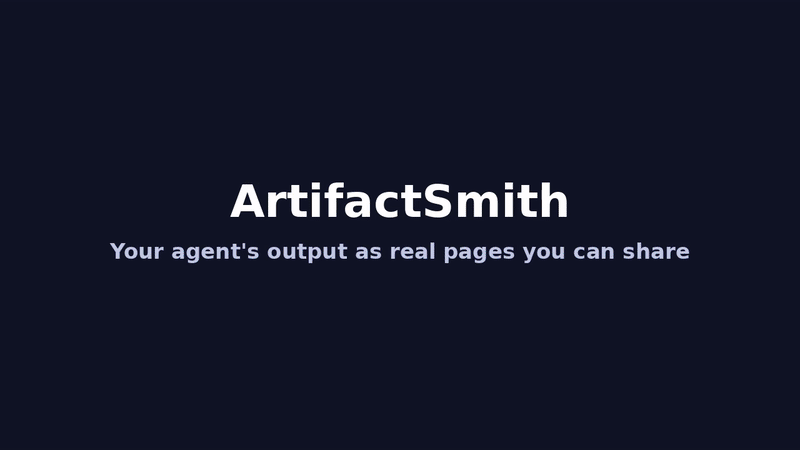
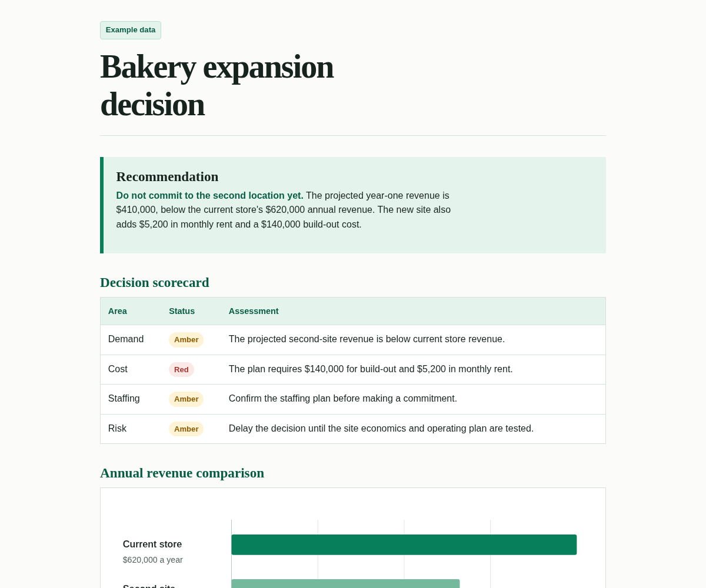
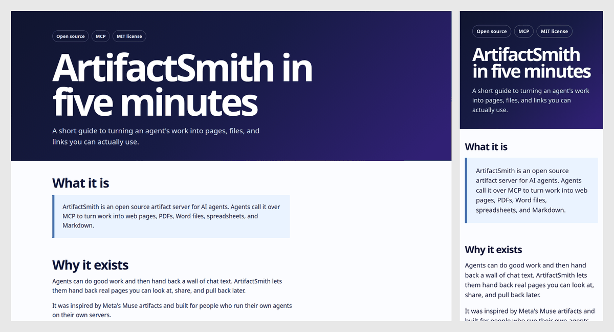
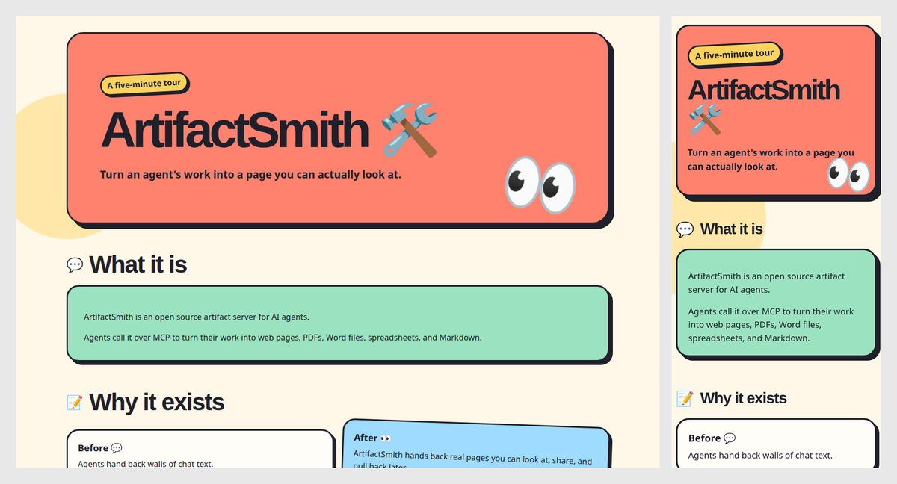
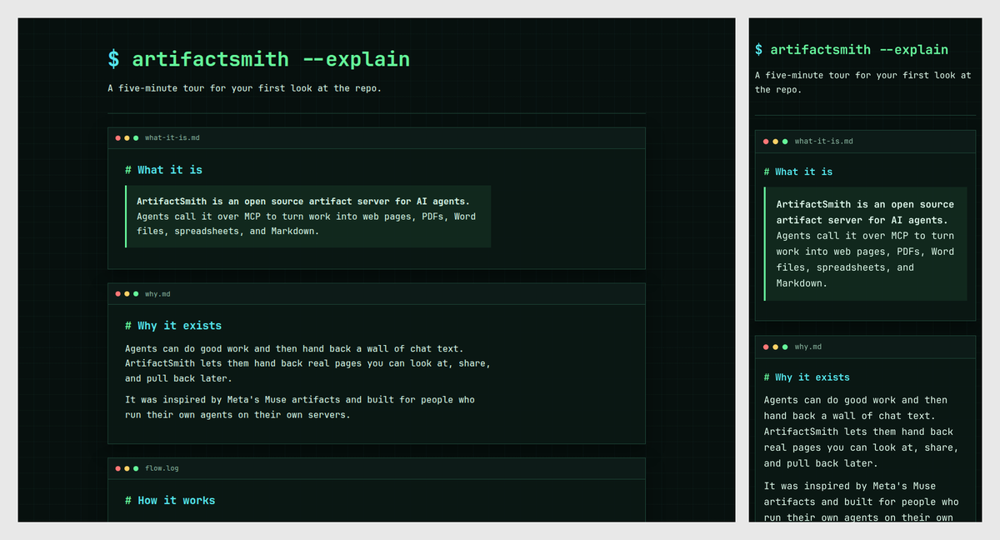
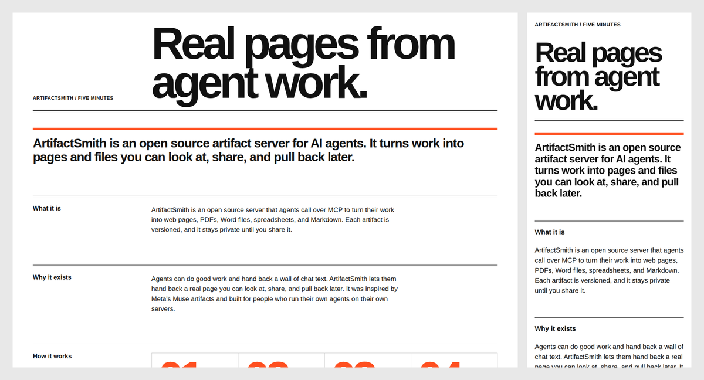

# ArtifactSmith

ArtifactSmith is an open source artifact server for AI agents.



Agents call it to turn their work into documents: web pages, PDFs, Word files, spreadsheets and Markdown. Each artifact is versioned and stays private until someone shares it, and a shared link can be revoked at any time.

It's for people who run their own agents and want artifacts like the ones in Muse on their own servers.

## Why I built this

My agents did good work and then handed it back as a wall of chat text. Useful, sure. Fun to read? Not so much.

Then I saw Meta's Muse artifacts, where the agent hands you a real page you can look at, share, and pull back later. I wanted that for my own agents, on my own servers. So I vibe coded it. And here we are.



## Quickstart

```bash
cp .env.example .env
# Set OPENAI_API_KEY (or AM_LLM_KEY). Change AM_LLM_BASE / AM_DEFAULT_MODEL
# only if you are not using the default OpenAI host and model.
# Object-store keys: leave them empty and run ./scripts/ensure-local-env.sh,
# or paste your own AM_STORE_KEY and AM_STORE_SECRET.
./scripts/ensure-local-env.sh
docker compose up -d --build

# Create a token (prints the raw value once; only its hash is stored).
# --workspace is a label that scopes every artifact the token can see
# (e.g. alpha, team-a). Tokens cannot cross workspaces.
docker compose exec server artifactsmith token add --name agent --workspace alpha
```

The server reads `AM_LLM_BASE`, `AM_LLM_KEY` or `OPENAI_API_KEY`, and `AM_DEFAULT_MODEL` from `.env`. The default base is `https://api.openai.com`. A trailing `/v1` on the base is fine; the client appends `/v1/chat/completions` itself.

Host ports bind to `127.0.0.1`:

- `http://127.0.0.1:8780/mcp` is the MCP API (bearer token required)
- `http://127.0.0.1:8781/` is the cookieless preview and share origin (`/p/…`, `/s/…`)

### Use the published image

`ghcr.io/vrijsinghani/artifactsmith:0.1.0` is published for `linux/amd64` on each release. Building from source (the Compose steps above) stays the default.

## Serving on your network or behind a proxy

Compose publishes API (`8780`) and preview/share (`8781`) on `AM_BIND_ADDRESS` (default `127.0.0.1`). Cards and links use `AM_API_URL`, `AM_PREVIEW_URL`, and `AM_SHARE_URL` (empty `AM_SHARE_URL` falls back to `AM_PREVIEW_URL`). Exposing the ports without TLS puts bearer tokens and artifact content on the wire in cleartext.

### LAN access

Bind on all interfaces (or a specific NIC IP) and point the public URL variables at the address clients will open:

```bash
# .env  (192.0.2.10 is documentation-range; substitute your LAN IP)
AM_BIND_ADDRESS=0.0.0.0
AM_API_URL=http://192.0.2.10:8780
AM_PREVIEW_URL=http://192.0.2.10:8781
AM_SHARE_URL=http://192.0.2.10:8781
AM_ALLOWED_HOSTS=192.0.2.10:8780,127.0.0.1:8780,localhost:8780
```

Then `docker compose up -d --build`. Clients open `http://192.0.2.10:8780/mcp` and preview/share links use `192.0.2.10`, not `127.0.0.1`. Browser-based MCP clients also need `AM_ALLOWED_ORIGINS` set to the page origin.

Share and preview URLs are built from `AM_SHARE_URL` / `AM_PREVIEW_URL` when the server returns them. Links you copied before switching to LAN serving still use the old base host; call `share` again (or copy the URL from `inspect` / `status`) after changing those settings.

### Reverse proxy with TLS

Keep the host bind on loopback and terminate TLS on nginx or Caddy. Set the public URLs and allow-lists to the external hostname:

```bash
# .env
AM_BIND_ADDRESS=127.0.0.1
AM_API_URL=https://artifacts.example.com
AM_PREVIEW_URL=https://preview.artifacts.example.com
AM_SHARE_URL=https://preview.artifacts.example.com
AM_ALLOWED_HOSTS=artifacts.example.com
AM_ALLOWED_ORIGINS=https://artifacts.example.com
```

Minimal Caddy example (API on 443, preview on a second hostname):

```caddy
artifacts.example.com {
  reverse_proxy 127.0.0.1:8780
}
preview.artifacts.example.com {
  reverse_proxy 127.0.0.1:8781
}
```

Minimal nginx snippet for the API host:

```nginx
server {
  listen 443 ssl;
  server_name artifacts.example.com;
  # ssl_certificate / ssl_certificate_key omitted
  location / {
    proxy_pass http://127.0.0.1:8780;
    proxy_set_header Host $host;
    proxy_set_header Authorization $http_authorization;
    # status wait can be up to 90s; nginx defaults cut at 60s.
    proxy_read_timeout 120s;
    proxy_send_timeout 120s;
  }
}
```

When `AM_ALLOWED_HOSTS` lists only the public hostname, a local `curl http://127.0.0.1:8780/mcp` gets HTTP 421 (DNS-rebinding protection). Point clients at the proxied hostname instead. Browser-based MCP clients send an `Origin` header; set `AM_ALLOWED_ORIGINS` to that origin or the request is rejected.

### MCP client on another machine

Point the client at `{AM_API_URL}/mcp` and send the token as `Authorization: Bearer <token>` (the value printed once by `artifactsmith token add`). Example:

```text
URL:    http://192.0.2.10:8780/mcp
Header: Authorization: Bearer asmb_…
```

## How it works

Agents talk to ArtifactSmith over MCP. They pass the user's request as `verbatim_request` and any research as `source_content` or `source_files`. `create` starts a private build and does not publish a share link. Want a styled page? Pass Markdown to `publish` and it is styled automatically (omit `format` when you pass markdown and no html; house style by default, applied when the page is opened). You can still pass `format=markdown`. Or call `create` with `source_content`. Raw HTML in `publish` is only for a page you designed yourself, and it is shown exactly as given.

The server calls an OpenAI-compatible endpoint (up to two attempts when checks fail). The model writes content. A fixed renderer turns that into HTML, Markdown, PDF, DOCX, or XLSX. `publish` skips the model and runs the same checks and renderer. Call `status` (or `wait` up to 90 seconds) to get a private preview.

`share` creates a public link for one exact version. `unshare` makes that link return 404. Tokens belong to one workspace and carry a permission set.

Documents may cite public http(s) sources as clickable links. The server strips scripts, rejects private-link hosts and likely secrets, and keeps images, CSS, fonts, and iframes self-contained so a download opens offline and does not phone home. Size limits apply. The process does not send usage data anywhere.

## Output formats

| Format     | `create(..., format=)` | Primary file    | Renderer |
| ---------- | ---------------------- | --------------- | -------- |
| HTML       | `html` (default)       | `index.html`    | sanitize, then store |
| Markdown   | `markdown`             | `document.md`   | UTF-8 text |
| PDF        | `pdf`                  | `document.pdf`  | [WeasyPrint](https://weasyprint.org/) (HTML/CSS to PDF) |
| DOCX       | `docx`                 | `document.docx` | [python-docx](https://python-docx.readthedocs.io/) |
| XLSX       | `xlsx`                 | `document.xlsx` | [openpyxl](https://openpyxl.readthedocs.io/) |

HTML uses a visual style (house by default) and stores a complete page. The other formats ask the model for Markdown, then a renderer converts it. `publish` accepts the finished HTML or Markdown and uses that same renderer. PDF, DOCX, and XLSX also store `content.md` so later edits have a text base.

PDF goes through WeasyPrint, which needs Pango and Cairo. The Docker image does not include Chromium. Details are in [docs/formats.md](docs/formats.md).

## Styles

`create` and `edit` take an optional `style` for HTML: `house`, `bold`, `editorial`, `playful`, `terminal`, or `swiss`. The default is `AM_DEFAULT_STYLE` (usually `house`). On markdown, PDF, DOCX, and XLSX the model prompt does not use that visual style. A published markdown page is still shown in the recorded style when it is opened. Omit `style` on `edit` to keep the last style.

`create` also takes `mode`: `full` (default, `AM_BUILD_MODE`) has the model write HTML. `fast` has the model write Markdown and the server render that style. `fast` is a first HTML build only. Edits and other formats stay on the full path. `AM_FAST_STYLES` (empty by default) lists styles whose omitted `mode` is `fast`; an explicit `mode` still wins. A complete HTML document in the source, or a request to publish that HTML as-is, stays on `full` when `mode` is omitted. Mentioning HTML beside "unchanged" does not.

- `house`: today's quiet page — white, one accent, boldness in one place.
- `bold`: dark navy-to-violet hero, huge white headline, saturated cards and chips.



- `editorial`: magazine feature — off-white paper, large serif headline, thin rules, one deep red accent.


- `playful`: cream page, candy-colored rounded cards, thick outlines and offset shadows.



- `terminal`: dark mode, monospace, neon green and cyan, sections as fake terminal windows.



- `swiss`: white grid, huge black grotesque type, signal-orange only on numbers and rules.



## MCP tools

| Tool | Permission | What it does |
| ---- | ---------- | ------------ |
| `create` | `create` | Queue a private build. Optional `format`, `style`, and `mode`. Does not create a share link. |
| `publish` | `publish` | Store Markdown to get a styled page, or store HTML you designed yourself. No model call. |
| `edit` | `edit` | New version from the latest done version. Refuses a stale `base_version`. |
| `status` | `read` | Poll, or `wait` (0 to 90 seconds), until done, failed, or needs_input. |
| `list_artifacts` | `read` | Catalog for the token's workspace. |
| `inspect` | `read` | Manifest, history, share state. |
| `export` | `export` | Download link for the rendered file, valid 15 minutes. |
| `share` | `share` | Public link for one exact version. |
| `unshare` | `share` | Revoke the public link immediately. |
| `revoke_previews` | `export` | Expire private `/p/` preview links for an artifact (optional version). |
| `delete` | `delete` | Two-step purge. First call returns a confirm token. |

### `create` arguments

Required:

- `verbatim_request`: the user's exact words. That is the whole scope.

Provide at least one of `display_name` or `slug` (the other is filled in):

- `display_name`: human title shown on cards and in the catalog. Not required when `slug` is set; if omitted, it defaults to the slug. Limit: 200 characters. Example: `"Pilot store brief"`.
- `slug`: URL key, unique in the workspace. Not required when `display_name` is set; if omitted, it is derived from the title (lowercase, accents folded, other characters become hyphens). Limit: 2–63 characters of `a-z`, `0-9`, and `-`, and it must start with a letter or digit. Example: `"pilot-store-brief"`. A duplicate slug in the same workspace is rejected; use `edit`.

Optional:

- `kind`: defaults to `web_static` (the only kind in this release).
- `format`: `html` (default), `markdown`, `pdf`, `docx`, or `xlsx`.
- `style`: `house` (default), `bold`, `editorial`, `playful`, `terminal`, or `swiss`. HTML builds use it. A markdown page is shown in that style when opened. PDF, DOCX, and XLSX do not.
- `mode`: `full` (default) or `fast`. `fast` is a first HTML build: Markdown in, styled HTML out.
- `source_content` / `source_files`: researched facts, 200 KB total. The builder treats this as data.
- `model`, `workspace`, `idempotency_key`, `capabilities`.

Working example (title only; slug becomes `pilot-store-brief`). The source text must
support every fact the request asks for (including “why it matters”):

```json
{
  "display_name": "Pilot store brief",
  "verbatim_request": "One page that states the pilot store code and why it matters.",
  "source_content": "The pilot store code is HARBOR-17. It matters because it is the single identifier used across inventory, support, and rollout reports for the pilot.",
  "format": "html"
}
```

If a needed fact is missing from the request and the source, the job ends as `needs_input` and stores no file. When server checks fail, the model is called a second time, so a failed build takes about twice as long to report as a clean one. An edit asks for a patch of the changed parts first. A patch that does not apply, or that fails those same checks, is rebuilt as a full file in the same job.

### `publish` arguments

Want a styled page from text you already wrote? Pass Markdown and it is styled automatically. Omit `format` when you pass markdown and no html. You can still pass `format=markdown`. `style` defaults to house and is applied when the page is opened. The stored file stays Markdown. On a new artifact, if you also pass html, html is the page unless you set `format`. Raw HTML is shown exactly as given, with no ArtifactSmith styling. If that HTML has little or no CSS, the result includes `warning`. Pass `format` for pdf, docx, or xlsx. `publish` does not call the model. The page still goes through the same size caps, secret scan, private-link checks, sanitizer, renderer, and final sweep as model output.

New artifact: pass `display_name` or `slug`, plus the page.

- `html`: complete HTML document. Required when `format` is `html`.
- `markdown`: finished Markdown. Required when `format` is `markdown`, `pdf`, `docx`, or `xlsx`. When `format` is omitted and this is the only body, the format is markdown.
- You may also pass the other field. It is checked for secrets and private links and is not rendered.

New version: pass `artifact_id` and `base_version` (the latest done version) plus the new page. Omit `format` and markdown with no html is markdown; html with no markdown is html; both fields keep the artifact's format. Pass `format` to choose another supported format. The artifact id and slug stay the same. Older versions keep their own format. A shared markdown page opens as styled HTML; `?raw=1` or `document.md` on that URL downloads the stored Markdown.

`summary` and `assumptions` are optional card fields (8000 characters each) and are scanned like model output. A longer summary or assumption is rejected when the call arrives, with `metadata exceeds N characters`, and nothing is stored. On markdown, `style` changes the opened page (`house` by default). On HTML, `style` is recorded and the submitted page is not restyled. PDF, DOCX, and XLSX do not use the HTML style sheet.

Returns `artifact_id`, `version`, and `job_id`. Call `status` until `done` or `failed`. A rejected page is `failed`, and `error` names the check that failed. `publish` does not create a share link. It counts toward the per-token build quota and needs the `publish` permission.

### `export`

Permission: `export`.

Arguments:

- `artifact_id` (required): which artifact to download.
- `version` (optional): a done version. Omit it to use the latest done version.

Returns `download_url` (valid 15 minutes), `file`, `version`, `sha256`, `self_contained`, and `expires_in` (`"15m"`).

```json
{ "artifact_id": "art_example", "version": 1 }
```

### `share`

Permission: `share`.

Arguments:

- `artifact_id` (required): which artifact to publish.
- `version` (optional): the exact done version. Omit it to use the latest done version.
- `ttl_days` (optional): lifetime in days. Defaults to `AM_SHARE_TTL_DAYS`. When `AM_SHARE_TTL_DAYS` is `0`, `ttl_days` is ignored and the link lasts until revoked. Otherwise the lifetime is capped by `AM_SHARE_TTL_MAX_DAYS`.

Returns `state` (`"shared"`), `url`, `version`, `expires_at`, `lifetime`, and `reused`. Anyone with the URL can open that version.

```json
{ "artifact_id": "art_example" }
```

### `unshare`

Permission: `share`.

Arguments:

- `artifact_id` (required): which artifact to revoke.
- `version` (optional): revoke one version. Omit it, or pass `0`, to revoke every version.

Returns `artifact_id`, `revoked_links` (how many links were revoked), and `state` (`"not_shared"`). The old URL returns 404 immediately.

```json
{ "artifact_id": "art_example" }
```

### `delete`

Permission: `delete`.

Arguments:

- `artifact_id` (required): which artifact to purge.
- `confirm_token` (omit on the first call): token from the first response. It expires in 10 minutes.

The first call does not delete anything. It returns `step` (`"confirm"`), `confirm_token`, `title`, `versions`, `expires_in` (`"10m"`), and a warning. The second call purges every stored version, share link, and database row. It returns `deleted` (`true`), `artifact_id`, and `purged_object_versions`.

```json
{ "artifact_id": "art_example" }
```

```json
{ "artifact_id": "art_example", "confirm_token": "paste-the-token" }
```
## Configuration

Every setting also has a `NAME_FILE` variant that reads the value from a file.

| Variable | Default | Purpose |
| -------- | ------- | ------- |
| `OPENAI_API_KEY` / `AM_LLM_KEY` | empty | LLM credential for the configured endpoint. |
| `AM_LLM_API` | `chat` | `chat` (Chat Completions) or `responses`. |
| `AM_LLM_BASE` | `https://api.openai.com` | OpenAI-compatible host root. With or without a trailing `/v1`. |
| `AM_LLM_TEMPERATURE` | unset | Chat Completions temperature. Unset sends `0`; `none` omits the field. |
| `AM_DEFAULT_MODEL` | `gpt-4o-mini` | Model name sent to the LLM. |
| `AM_DEFAULT_STYLE` | `house` | HTML visual style when `create` omits `style`. |
| `AM_BUILD_MODE` | `full` | `full` or `fast` when `create` omits `mode`. `fast` is first-build HTML only. |
| `AM_FAST_STYLES` | empty | Comma-separated styles (`house`, `bold`, …) that default to `fast` when `create` omits `mode`. Empty keeps `AM_BUILD_MODE` for every style. An explicit `mode` still wins. A finished HTML source, or a request to publish that HTML as-is, stays `full` when `mode` is omitted. Mentioning HTML beside "unchanged" does not. Other formats and edits stay `full`. An unknown name fails at startup. |
| `AM_SHARE_TTL_DAYS` | `30` | `0` means until revoked. |
| `AM_SHARE_TTL_MAX_DAYS` | `365` | Cap on positive TTLs. |
| `AM_STORE_ENDPOINT` | (required) | S3-compatible object store. |
| `AM_STORE_BUCKET` | `artifacts` | Bucket name. |
| `AM_STORE_KEY` / `AM_STORE_SECRET` | (required) | Object-store credentials. |
| `AM_BLOCK_PRIVATE_LINKS` | `true` | Reject localhost, RFC1918, and link-local hosts in output. |
| `AM_ALLOWED_LINK_DOMAINS` | empty | If set, every remaining host must match. |
| `AM_MAX_OUTPUT_BYTES` | 50 MiB | Rendered output cap. |
| `AM_RENDER_TIMEOUT` | `120` | Seconds for one renderer call. |
| `AM_BUILD_TIMEOUT` | `900` | Seconds for the whole job. |
| `AM_EDIT_PATCH_TIMEOUT_S` | `45` | Seconds for the edit patch call. A timeout falls back to a full rewrite. |
| `AM_MAX_BUILDS` | `2` | Concurrent workers. |
| `AM_BUILDS_PER_HOUR` | `20` | Per-token quota. |
| `AM_HOST` | `127.0.0.1` | Listen address for `artifactsmith serve`. Compose/image set `0.0.0.0` in-container. |
| `AM_BIND_ADDRESS` | `127.0.0.1` | Host publish bind for ports `8780` and `8781` in `compose.yaml`. |
| `AM_API_PORT` / `AM_PREVIEW_PORT` | `8780` / `8781` | Listen ports. |
| `AM_API_URL` / `AM_PREVIEW_URL` / `AM_SHARE_URL` | `http://127.0.0.1:8780` / `:8781` | URLs written into cards and links. Empty `AM_SHARE_URL` uses `AM_PREVIEW_URL`. |
| `AM_ALLOWED_HOSTS` | `127.0.0.1:<api_port>,localhost:<api_port>` | Comma-separated Host values for MCP DNS-rebinding protection (on by default). |
| `AM_ALLOWED_ORIGINS` | empty | Comma-separated Origin values for MCP DNS-rebinding protection. |
| `AM_DATA_DIR` / `AM_SECRETS_DIR` | `/data` / `/secrets` | SQLite and the HMAC signing key. |

Copy `.env.example` for a local file. `./scripts/ensure-local-env.sh` fills empty `AM_STORE_KEY` and `AM_STORE_SECRET`. The storage image is `rustfs/rustfs:1.0.1` (pinned by digest in `compose.yaml`).

## Security

Tokens are issued per workspace and stored as SHA-256 hashes. Knowing an artifact id does not grant access.

Permissions are `create`, `read`, `edit`, `publish`, `export`, `share`, and `delete`.

Builds stay private until you call `share`. That creates a public `/s/…` URL that follows the latest done version. Pass `version` or `pin` to freeze one version on its own URL. `unshare` makes it return 404. `unshare` with a version revokes only that pin.

Preview and share pages run on their own port, send no cookies, and set CSP `script-src 'none'` with `sandbox allow-popups allow-popups-to-escape-sandbox allow-top-navigation-by-user-activation`.

Scripts are stripped. Public http(s) links to global hosts are kept (with `rel="noopener noreferrer nofollow"` and `target="_blank"` in HTML). In-page `#` anchors stay on the page. Host checks use urllib plus a WHATWG-style approximation; they guarantee accepted links do not reach private hosts, not that every accepted link is browser-valid. Protocol-relative `//host` citations are upgraded to `https://` only when the host is public; private or dangerous `//` destinations are neutralized, not upgraded. Private, loopback, and link-local hosts fail the build, as do `javascript:`, `vbscript:`, `data:`, and `file:`. A remote image URL becomes a clickable link to that URL (alt text as the label) in every format — nothing loads the image on open. CSS `url()`, fonts, and iframes stay local. Secrets fail the build. Size and time caps apply.

The process does not send usage data anywhere.

[docs/threat-model.md](docs/threat-model.md) and [SECURITY.md](SECURITY.md) have the rest.

## Tokens

A **workspace** is a namespace for artifacts (for example `alpha` or `team-a`). Each token belongs to exactly one workspace and can only create or read artifacts in that workspace. Knowing an artifact id from another workspace does not grant access.

```bash
artifactsmith token add --name NAME --workspace WS [--perms create,read,edit,publish,export,share,delete]
artifactsmith token list
artifactsmith token revoke --id ID | --name NAME
artifactsmith token perms --id ID | --name NAME
artifactsmith token perms --name NAME --add publish
artifactsmith token perms --name NAME --remove publish
```

`token perms` changes one permission on an existing token. The token value stays the same. Each add or remove appends one line to the audit log. Listing permissions does not. If the name matches more than one token, pass `--id`.

## Uninstall / reset

```bash
# Stop containers, delete compose volumes, and remove images created for this project
# (server, storage-init, and the rustfs/rustfs pull). Requires store keys in .env like other compose commands.
docker compose down --volumes --rmi all
```

Copy `.env.example` again and re-run the quickstart to start clean.

## Development

```bash
python3 -m venv .venv && source .venv/bin/activate
make install
make ci          # lint, types, unit tests, denylist
```

### Running the tests

`make test` runs the unit suite with the same `pytest` command CI uses. It does not start Docker.

End-to-end tests use `compose.test.yaml`, which adds a fake chat model from `tests/support/`.

```bash
./scripts/ensure-local-env.sh
docker compose -f compose.yaml -f compose.test.yaml up -d --build
python -m tests.e2e.test_end_to_end
python -m tests.e2e.test_formats
python -m tests.e2e.test_bind_address   # AM_BIND_ADDRESS=0.0.0.0 via non-loopback IP
```

`make smoke` runs the same stack and scripts. Compose commands need a `.env` with `AM_STORE_KEY` and `AM_STORE_SECRET` set (including `docker compose down`), because those variables are required by `compose.yaml`.

[docs/architecture.md](docs/architecture.md), [docs/operations.md](docs/operations.md), [CONTRIBUTING.md](CONTRIBUTING.md).

## How this was built

Artifactsmith was vibe-coded. A person set the direction and made the calls, and AI agents wrote and checked the code:

- **Grok Bot** ran the project. It planned the work, reviewed every pull request file by file, and decided what had to be fixed before anything merged.
- **Cursor** cloud agents wrote the code, tests and docs, and fixed what the reviews found.
- **Hermes** agents gave independent checks. One reviewed the code as a senior engineer and signed off on each round. Another installed it from scratch, following only this README, the way a new user would.

Before release it went through:

- Several rounds of line-by-line code review, each one repeated until no blocking issues were left.
- An independent security audit with Semgrep, Bandit, gitleaks, pip-audit and Trivy, plus a written threat model.
- Hands-on attack testing of the HTML cleaner, link handling and export formats.
- Real builds with a live model in all five formats, checking that links stay clickable and nothing loads from outside when a document is opened.
- Clean installs on a separate machine, including serving it to other machines on a local network.
- Automated checks on every change: lint, strict type checking, unit tests on Python 3.11 and 3.12, a Docker build, dependency scanning, and secret scanning.

The audit report is in `docs/security-audit-2026-10-09.md`. If you find something we missed, see `SECURITY.md`.

## License

MIT. House-style writing and visual rules are adapted from Humanizer (MIT) and Anthropic frontend-design (Apache-2.0). Attribution is in `NOTICE`; third-party license texts are under `licenses/`. The Docker image ships those files at `/app`.
