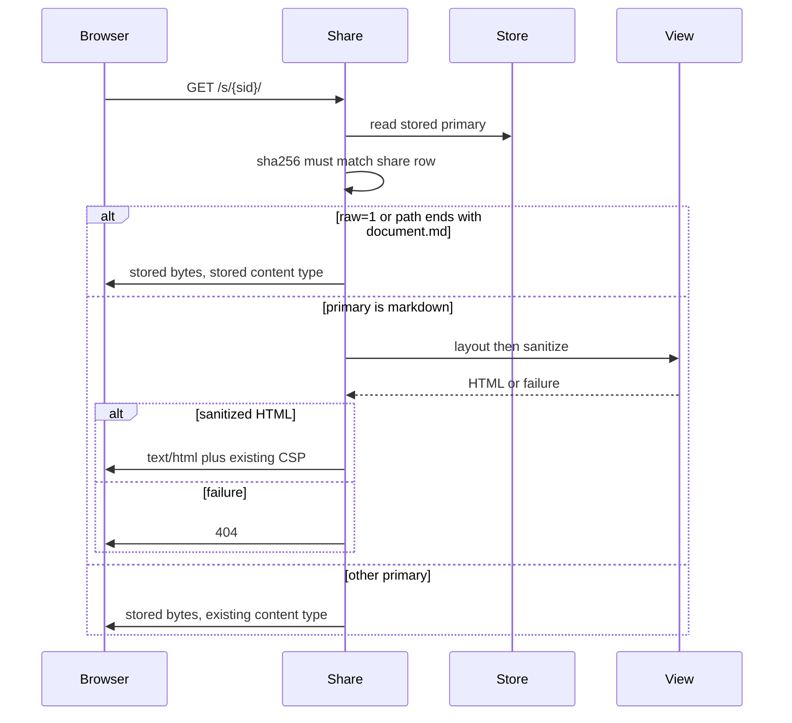
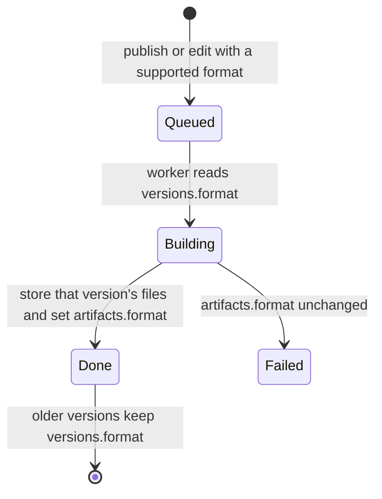

# Markdown Share HTML and Version Format - Plan

## Goal Capsule

**Objective:** Someone opening a shared markdown artifact sees a styled page, and a later version of that same artifact can be a different supported format while the artifact id, slug, and share identity of each version stay put.

**Means:** Render the HTML view when the share or preview is read, from the markdown already stored (KTD1). Record each version's format and update the artifact's current format only when that version finishes (KTD2).

**Authority:** This plan, then the repository's sanitizer, CSP, and link policy. A shorter path that skips those checks is out of bounds.

**Stop:** Do not merge or deploy. Do not change the CLI. Do not weaken the sanitizer, response CSP, link policy, auth, or tokens. Do not rewrite stored markdown bytes.

**Who ships:** The PM reviews the pull request and ships it. This work opens the pull request ready for review.

## Product Contract

### Summary

Shared markdown artifacts currently arrive in the browser as raw `text/markdown`. A new version also cannot change format, so the owner had to publish a second artifact and the original link stayed raw. After this change, the share page is house-styled HTML, the markdown file remains downloadable, and publish or edit can switch format on the same artifact.

### Problem Frame

Live share `/s/6th3dcnycpkqmgf7/` (`art_tcac25dfw66zf7`, format markdown) is served as `content-type: text/markdown; charset=utf-8` with raw `#` and `|` in the browser. The owner republished as a new HTML artifact, which broke the shared link.

`MarkdownRenderer` stores only `document.md`. The share handler serves that primary file as-is. `publish_version` rejects any format other than the one on the artifact, and the publish tool text says format stays fixed.

### Requirements

**Share view**

- R1. The `/s/{sid}/` page for a markdown primary is `text/html` with charset utf-8, house-styled, and includes headings, lists, tables, and code from the markdown.
- R2. That HTML passes the same document sanitizer, link policy, and response CSP as an HTML artifact. A script in the markdown does not survive as an executable script.
- R3. The stored markdown stays downloadable at `/s/{sid}/document.md` and at `/s/{sid}/?raw=1`, with content type `text/markdown` and the original bytes.
- R4. An existing markdown artifact renders as that HTML view after deploy without republishing and without rewriting its stored object or share hash.

**Format change**

- R5. `publish` of a new version, and `edit`, accept a different `format` that is one of `SUPPORTED_FORMATS`. The new version is built in that format. When it reaches done, `artifacts.format` becomes that format. The artifact id and slug do not change.
- R6. An omitted format keeps the artifact's current format.
- R7. An invalid format is rejected before a job is queued, with the same class of error create already uses (`format must be one of …`).
- R8. Older versions keep the format they were built with. Export, inspect history, and a later edit's base file use that version's format, not the artifact's later format.
- R9. A failed or still-queued format-changing job does not change `artifacts.format`.

**Unchanged surfaces**

- R10. Export and the `/dl/` download return the stored primary file. A markdown export still begins with the markdown bytes, not HTML.
- R11. Preview (`/p/`) uses the same HTML view as the share page. The response CSP header is unchanged.
- R12. Tool text for `publish` and `edit` states that a version may change format. The changelog records the behavior.

### Actors

- A1. A reader with a share link, who has no token.
- A2. An owner using publish or edit, who holds the existing permission for that call.

### Flows

- F1. Reader opens `/s/{sid}/` for a done markdown version and receives styled HTML.
- F2. Reader requests `?raw=1` or `/document.md` and receives the stored markdown.
- F3. Owner publishes or edits with a new supported format. After the job is done, the artifact's current format matches the new version, and the previous version still exports as its own format.

### Acceptance Examples

- AE1. A seeded markdown artifact whose primary is `document.md` and whose body contains `HARBOR-17` returns `text/html` on `GET /s/{sid}/`, the body contains `HARBOR-17`, and the response is not `text/markdown`. Covers R1, R4.
- AE2. The same share with `?raw=1`, and `GET /s/{sid}/document.md`, return `text/markdown` and the original `#` heading. Covers R3.
- AE3. Publish version 2 of an HTML artifact with `format=markdown`. Slug and artifact id stay the same. After the job, `artifacts.format` is markdown, version 2's primary is `document.md`, and version 1's stored HTML is unchanged. The reverse, markdown to HTML, holds the same way. Covers R5, R8.
- AE4. `format=rtf` on publish or edit raises before a job exists. Covers R7.

### Scope Boundaries

- The CLI `bin/asmith` is outside this repo.
- PDF, DOCX, and XLSX shares keep serving their stored primary. Their `content.md` sidecar is not turned into the share page.
- No startup rewrite of object-store bytes.
- Secret-scanner placeholders, edit error text, and bold `pre` wrapping are a separate pull request.

### Deferred to Follow-Up Work

- Placeholder secrets, named edit failures, and bold `pre` overflow at 390 px, specified in `specs/queued/2026-10-13-placeholder-secrets-edit-errors-pre-wrap.md`.

### Sources

- Live share `art_tcac25dfw66zf7` served as `text/markdown` on 2026-10-14.
- `src/artifactsmith/renderers/markdown.py`, `src/artifactsmith/server.py` (`shared`, `preview`, publish and edit tool text), `src/artifactsmith/publish_version.py` (format lock), `src/artifactsmith/service.py` (`_execute_build`, `_source_name`, `export`, `inspect`), `src/artifactsmith/db.py` (versions table and `_migrate`).

## Planning Contract

### Key Technical Decisions

- KTD1. Render HTML at request time. Do not backfill stored objects on startup. The share hash is the sha256 of the stored primary; replacing that object would 404 every existing share. Hash the stored bytes first, then render. On render or sanitize failure, return 404 and do not fall back to raw markdown as the page.
- KTD2. Add nullable `versions.format`. At migration, copy `artifacts.format` onto every version whose format is null, because format was fixed until now, so that copy is the historical format. New create, edit, and publish inserts set the column. Readers use the version's format. `artifacts.format` updates in the same transaction that marks the version done, and only then.
- KTD3. The HTML view applies when the primary file is markdown (`document.md`, or a content type that starts with `text/markdown`). A `content.md` sidecar next to PDF, DOCX, or XLSX is not the primary, so those shares stay binary.
- KTD4. Build the view with the existing house layout renderer, then the existing HTML document sanitizer, then the same content check HTML builds run after render (`check_content` for secrets, private links, the link allow-list, and a complete document). Do not add a markdown parser. The response CSP header stays the preview-origin CSP. Preview uses this view. Export and `/dl/` do not.
- KTD5. The worker, the manifest `format` field, export's extension, and base-file lookup use the version format from KTD2. `_source_name` uses the base version's format so an edit after a format change still loads that version's editable file (`index.html`, `document.md`, or `content.md`).

### High-Level Technical Design

Share and preview read path:

Format-changing version:

### Assumptions

- House layout already covers tables, headings, code, lists, and a phone stylesheet, including a viewport meta. A unit test that the served HTML is a sanitized document with the fact present is the proof for the 390 px requirement. A live 390 px browser pass is not required for this pull request.
- Idempotency fingerprints that include format will treat the same key with a different format as a different request. That is the existing fingerprint conflict behavior.
- Create already writes `artifacts.format` when the artifact is inserted. That stays, and the version row records the same format. Only a later version waits until done to change the artifact format.

### Sequencing

U1 can land beside U2. U3 depends on U2 because the worker must build the version's format. U4 depends on U1 and U3.

## Implementation Units

### U1. Serve-time HTML view

**Goal:** Markdown shares and previews open as sanitized HTML, and the stored markdown stays downloadable.

**Requirements:** R1, R2, R3, R4, R10, R11

**Dependencies:** none

**Files:** `src/artifactsmith/markdown_view.py`, `src/artifactsmith/server.py`, `tests/unit/test_server.py`

**Approach:**

1. Add a small helper that decodes the stored markdown, runs the house layout renderer with the version style (default house) and the artifact title, then runs `sanitize_html_document`. Run `check_content` on that HTML with format html, the configured private-link flag, and the configured link allow-list. Any problem, or a layout or sanitize failure, is a failure. Return HTML bytes only when those checks pass.
2. Treat the primary as markdown only when the file name is `document.md` or the stored content type starts with `text/markdown`.
3. In `shared` and `preview`, keep the current read. On a share, keep the sha256 check against the stored bytes before any render.
4. If the request is `raw=1` or the path ends in `/document.md`, serve those stored bytes with the stored content type. Use an attachment disposition for `/document.md`.
5. Otherwise, if the primary is markdown, render off the event loop and serve `text/html; charset=utf-8` through the existing `_serve` helper so the CSP header is unchanged. If layout or sanitize fails, return 404.
6. Add routes for `/s/{sid}/document.md` and `/p/{token}/document.md`. Leave `/dl/` as the stored file.

**Patterns to follow:** `shared` and `_serve` in `src/artifactsmith/server.py`. `render_layout` in `src/artifactsmith/layout/render.py`. `sanitize_html_document` in `src/artifactsmith/renderers/html_sanitize.py`.

**Test scenarios:**

- Seed a done markdown artifact whose `document.md` contains `# Pilot` and `HARBOR-17`. `GET /s/{sid}/` returns 200, `text/html`, a body that contains `HARBOR-17` and an HTML document marker, and does not use `text/markdown`.
- The same seed with `?raw=1` and `GET /s/{sid}/document.md` returns `text/markdown` and the `# Pilot` bytes.
- Markdown that contains a script tag is served as HTML without a live script element.
- A markdown share whose raw HTML block contains an entity-encoded https link to a host outside the configured allow-list is not served as a page with that live href.
- An existing HTML share test still returns the stored HTML.
- A share whose stored bytes do not match `sha256` is 404 and is not rendered.
- A PDF primary is not passed through the markdown view.

**Verification:** The unit tests above pass, and a grep of the share path shows `sanitize_html_document` on the markdown view and the existing CSP constant still set on the response.

### U2. Format stored on the version

**Goal:** Each version has its own format, including rows that already exist.

**Requirements:** R8, R9

**Dependencies:** none

**Files:** `src/artifactsmith/db.py`, `src/artifactsmith/service.py`, `src/artifactsmith/publish_common.py`

**Approach:**

1. Add `format TEXT` to the versions `CREATE TABLE` and, in `_migrate`, add the column when missing. In that same migration, set `versions.format` from `artifacts.format` where the version format is null.
2. Add a helper that reads `versions.format` and does not substitute the artifact's current format once the column is populated.
3. Thread `format` through `insert_version` and through the create and edit inserts.
4. In `_execute_build`, pass the version format to `publish_page` and `run_build`, including the fast-mode gate that forces full mode when format is not html. When the base version's format differs from the version being built, skip the edit-patch call. That call patches the previous file and would store the old format's bytes under the new name. A full rewrite produces the new format. Write the version format into the manifest. In the done transaction, set `artifacts.format` to the version format.
5. `export` uses the version format for the file extension. `_source_name` uses the version row it is naming, which for a base version is that base version's format. Inspect history includes `format`.

**Patterns to follow:** `_migrate` additions for `style`, `publish_json`, and `mode` in `src/artifactsmith/db.py`.

**Test scenarios:**

- A database created before the column, then opened by current code, has `versions.format` equal to that artifact's format.
- After a successful format-changing job, a failed job's artifact format is unchanged. Covered with U3's failure case.
- Export of an old version uses that version's extension. The scenario is listed on U3.

**Verification:** New and migrated databases both have the column, and no reader of a finished version uses `artifacts.format` as a substitute for a null version format after migration.

### U3. Publish and edit accept a new format

**Goal:** A version may change format. An invalid format never queues.

**Requirements:** R5, R6, R7, R12

**Dependencies:** U2

**Files:** `src/artifactsmith/publish_version.py`, `src/artifactsmith/service.py`, `src/artifactsmith/server.py`, `tests/unit/test_publish.py`, `tests/unit/test_edit.py` or the existing edit test module

**Approach:**

1. Remove the fixed-format error. If format is omitted, use the artifact format. If it is present, normalize and require membership in `SUPPORTED_FORMATS` with the create error text.
2. Pass that format into the version insert and the idempotency fingerprint.
3. Add optional `format` to `edit` and to the edit tool. Default it to the artifact format. Include it in the edit fingerprint.
4. Replace the publish tool sentence that says format stays fixed. State that a new version may pass a different supported format, and that the artifact id and slug stay the same. Document the same for edit.
5. Do not update `artifacts.format` inside `publish_version` or `edit`. U2's done transaction does that.

**Patterns to follow:** `publish_new.py` format check. Existing `test_publish_new_version` in `tests/unit/test_publish.py`.

**Test scenarios:**

- HTML version 1, then publish `format=markdown`. Slug and artifact id unchanged. After the job, artifact format is markdown, version 2 primary is `document.md`, version 1 files remain HTML.
- Markdown version 1, then publish `format=html`. After the job, artifact format is html and version 1 remains markdown.
- Omitted format on publish still builds the current format.
- `format=rtf` on publish raises and leaves no new version.
- Edit with `format=markdown` on an HTML artifact uses a full rewrite, not a patch of `index.html`. The fake model reply is a complete markdown file. After the job, the primary is `document.md`, the bytes are markdown, and the previous version's format stays html.
- Export of that previous version uses the html extension, not `.md`.
- Edit with `format=rtf` raises before a job.

**Verification:** The tests above pass, and a failed publish job does not change `artifacts.format`.

### U4. Docs and format smoke

**Goal:** The e2e format smoke and the changelog match the new share behavior.

**Requirements:** R1, R10, R12

**Dependencies:** U1, U3

**Files:** `tests/e2e/test_formats.py`, `CHANGELOG.md`, `README.md` if it still says format is fixed

**Approach:**

1. Keep the markdown export assertion that the download starts with `# `.
2. After the markdown artifact is done, GET its share URL and assert `text/html` and `HARBOR-17`. GET `?raw=1` and assert markdown.
3. Add a changelog entry under Unreleased. Update README only where it still says a version cannot change format.

**Test scenarios:**

- The existing e2e format loop still passes for markdown, pdf, docx, and xlsx, with the added share assertions on markdown.

**Verification:** `tests/e2e/test_formats.py` assertions match R1 and R10. Changelog mentions serve-time HTML and per-version format.

## Verification Contract

Local, from the repo root with the project venv active:

- `ruff check` and `ruff format --check` on the touched files
- `mypy --strict src`
- `pytest -o addopts= --cov-fail-under=0` for `tests/unit/test_server.py`, `tests/unit/test_publish.py`, the edit test module, and `tests/e2e/test_formats.py`
- `bash scripts/denylist.sh` after `git add` of named files

CI remains the coverage gate (`--cov-fail-under=80`) plus lint, types, image, dependency scan, compose smoke, bind-address smoke, and GitGuardian.

## Definition of Done

- U1 through U4 are implemented and their test scenarios pass.
- Existing markdown bytes are not rewritten. The serve path hashes those bytes before rendering.
- Rendered markdown goes through `sanitize_html_document`, and the response still sets the existing CSP.
- Publish and edit can change format among `SUPPORTED_FORMATS`. Invalid format is rejected. Old versions keep their format. Slug and artifact id stay the same.
- Changelog is updated. The pull request is open against `main`, ready for review, and not merged.
