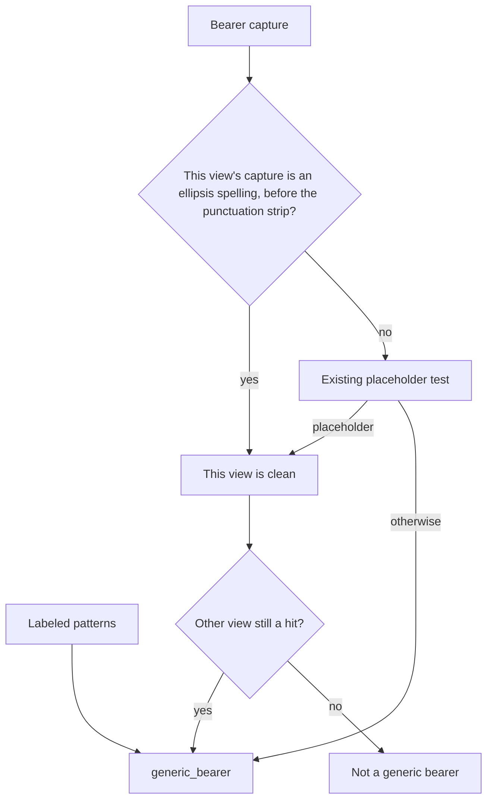

# Placeholder Secrets, Edit Errors, and Bold Pre - Plan

## Goal Capsule

- **Objective:** An author can leave the obvious token placeholders in an example, a failed content check on an edit names that check, any other edit failure still stores only the exception class, and a bold page at phone width stays in the viewport.
- **Means:** Allow the two ellipsis spellings on the existing bearer check (KTD1). Store the check name without copied source (KTD2). Keep the code box as a scrollport that fits the page (KTD3).
- **Authority:** This plan, then the brief's six placeholder strings and the "do not weaken detection" rule. A later idea that widens the allowlist or the denylist loses.
- **Execution:** One pull request from current main. The implementer opens it ready for review. The product owner reviews and ships.
- **Stop:** Do not merge or deploy. Do not change `scripts/denylist.sh`, the labeled secret patterns, the sanitizer, CSP, link policy, or token auth.

## Product Contract

### Summary

Docs and examples use a few placeholder tokens that the secret scan treats as real, a failed edit reports only `build failed: BuildError`, and a long line in a bold code box can push the page sideways on a phone. This plan lets those placeholders through, names the failed check, and keeps the long line inside the code box.

### Problem Frame

The scanner already ignores words like `YOUR_TOKEN` and angle-bracket placeholders, and it has no length floor, so a short bearer is a hit. Two spellings of an ArtifactSmith sample token collapse to that short hit after Unicode normalization and punctuation stripping. Separately, the worker drops the builder's check list when it stores an edit failure, and the bold code box is sized so its padding sits outside the page width.

### Key Decisions

- Exact six-form allowance. The brief names the forms and says a near-miss real token still fails. Governs R1, R2.

### Requirements

**Placeholders**

- R1. These strings produce no secret finding: `Bearer <token>`, `Bearer asmb_…` (U+2026), `Bearer asmb_...`, `Bearer YOUR_TOKEN`, `$AM_TOKEN`, and `${AM_TOKEN}`.
- R2. A bearer that continues after either ellipsis, a bare `Bearer asmb_`, and today's labeled secret shapes still fail the same way they do now.

**Edit failures**

- R3. When an edit fails a content check, the job error names that check and a reason that does not include the source text, a password, or a copied URL.
- R4. A failure that is not a content-check `BuildError` still stores only the exception class.

**Bold pages**

- R5. On the bold style, a long `pre` line at 390px and at 360px does not make the page scroll sideways, and the line stays reachable inside the code box.

**Unchanged detection**

- R6. `scripts/denylist.sh` and the labeled secret patterns stay unchanged.

### Scope Boundaries

- The allowance is the six strings in R1. It is not a prefix, a stopword, or a shorter length floor.
- Publish already names the check. This work does not add a second wording for publish.
- The PDF `pre` wrap in `src/artifactsmith/renderers/md_parse.py` is a different sheet.
- Sanitizer, CSP, link policy, auth, and tokens stay as they are.
- No new secret-scanning library and no extra model call to explain a failure.

#### Deferred to Follow-Up Work

- Markdown shares rendered as HTML, and versions that change format, are the other pull request.

### Acceptance Examples

- AE1. Covers R1, R2. Given `Bearer asmb_...` alone, the scan is clean. Given the same prefix plus `9f3a1c7e5b2d8a40` after the dots, the scan reports `generic_bearer`.
- AE2. Covers R3, R4. Given an edit whose build fails the secret check, the job error includes `possible secret (generic_bearer)` and does not include the token text. Given a blocked HTML attribute whose value holds a password, the job error names the check and does not include that password. Given a builder crash that is a plain `RuntimeError`, the job error is `build failed: RuntimeError` and the crash text is absent.
- AE3. Covers R5. Given a bold page with one long unbroken code line, at 390px and at 360px the document does not scroll sideways and that line is inside the code box.

### Risks & Dependencies

- Allowing the stripped token `asmb_` would also clear `Bearer asmb_`, which R2 forbids. KTD1 is the match that avoids that. U+2026 is outside the bearer token class, and NFKC folds it to three ASCII dots, so each view is judged on its own.
- A page-level scroll check can pass while `overflow-x: clip` on the body hides the line. The phone check has to show the line is inside the code box.
- Bold's stylesheet is 8190 bytes against a limit under 8192. A shared rule that grows the sheet pushes bold over the limit.
- `find_secrets` runs for create, edit, and publish, on HTML and Markdown, including field checks. R1 applies on all of those paths. The job-text change applies to create as well as edit, because they share the worker catch. Storing the full builder message would copy attribute values and some raw URLs into the job error. KTD2 drops those values.

## Planning Contract

### Key Technical Decisions

- KTD1. On each scan view, before trailing `.` and `,` are stripped, treat the bearer capture as a non-secret only when it is exactly `asmb_...`, or it is exactly `asmb_` and the next character is U+2026 with no token character after that. A clean view does not erase a hit on the other view. Leave the existing placeholder pattern in place. A second secret in the same text still fails. Four of the six R1 strings are already clean (`Bearer <token>`, `Bearer YOUR_TOKEN`, `$AM_TOKEN`, `${AM_TOKEN}`). The directive that all six are currently caught does not hold. Tests still cover all six. Bake-off does not apply: this spelling check and a stripped-token exemption are both concrete, and the exemption violates R2.
- KTD2. Store the builder message only when it starts with `builder output failed checks twice:`. Drop the copied value from a blocked HTML attribute clause. On a private-link or allow-list clause, keep the static sentence and drop the host or raw URL, because a single-label host can be a token or a password. Keep secret labels and the other static sentences. Any other exception, including a `BuildError` without that prefix, stays the class-only line. Publish keeps today's full message.
- KTD3. Keep `white-space: pre` and `overflow-x: auto` on the code box. The box is block-level, so put its padding inside its max width and the long line scrolls inside that box. Bold's stylesheet stays under 8192 bytes. The shared rule grows every style, so pay for the added bytes by removing insignificant whitespace from the bold extra block only, without changing its selectors, properties, or values. Do not add `overflow-wrap: anywhere` and do not switch the line to wrap. The brief allows wrap or scroll. The house sheet already scrolls code.

### High-Level Technical Design

### Assumptions

- Create uses the same worker catch as edit, so a content-check failure on create names the check too. The brief asked for edit. Publish's current error text stays.
- The phone fix is an inner scrollport, not wrapping the line.
- The 390px check uses the existing browser test when Chrome is present. The stylesheet length check runs even when Chrome is missing.

### Sequencing

U1 first, then U2 and U3 in either order. U1 must not touch the denylist or the labeled patterns. U3 must not grow the bold sheet past the cap.

## Implementation Units

### U1. Ellipsis placeholder allowance

- **Goal:** The two `asmb_` ellipsis spellings pass the bearer check, and near-misses still fail.
- **Requirements:** R1, R2, R6
- **Dependencies:** none
- **Files:** `src/artifactsmith/renderers/safety.py`, `tests/unit/test_bearer_secrets.py`, `CHANGELOG.md`
- **Approach:** Add the per-view check from KTD1 in the bearer decision. Do not edit `SECRET_PATTERNS` or `scripts/denylist.sh`. One changelog line under `## [Unreleased]` / `### Fixed`.
- **Execution note:** Add the two passing spellings and the near-miss cases before changing the matcher, so a too-wide allowance fails the near-misses.
- **Patterns to follow:** `tests/unit/test_bearer_secrets.py` parametrizes `find_secrets`, `check_fields`, and `check_content` for HTML and Markdown.
- **Test scenarios:**
  - Each of the six R1 strings is clean through `find_secrets`, `check_fields`, and `check_content` for HTML and Markdown.
  - `Bearer asmb_`, `Bearer asmb_.`, `Bearer asmb_,`, and `Bearer asmb_....` still report `generic_bearer`.
  - `Bearer asmb_...9f3a1c7e5b2d8a40` and `Bearer asmb_…9f3a1c7e5b2d8a40` still report `generic_bearer`.
  - `Bearer asmb_` followed by three fullwidth full stops still reports `generic_bearer`, because the normalized view looks like the placeholder and the raw view does not.
  - A string that contains an allowed placeholder and `ghp_` plus 36 a's still reports `github_pat`.
  - The existing realistic-token and other-pattern cases stay green.
- **Verification:** The new cases pass, and the denylist script still passes with no pattern edit.

### U2. Name the failed check

- **Goal:** A content-check failure on edit stores the check name without copied source.
- **Requirements:** R3, R4
- **Dependencies:** none
- **Files:** `src/artifactsmith/service.py`, `tests/unit/test_service.py`, `CHANGELOG.md`
- **Approach:** Apply KTD2 in the worker catch. Do not add a model call. One changelog line under `### Fixed`.
- **Patterns to follow:** Publish already keeps `str` of this exception. The timeout and oversize test shows the class-only line for a plain `RuntimeError`.
- **Test scenarios:**
  - An edit whose build raises `BuildError` starting with `builder output failed checks twice:` and including `possible secret (generic_bearer)` stores that label, not `build failed: BuildError`, and does not store a sample token from the source.
  - The same failure with `blocked or authority-confused HTML href:` plus a userinfo password stores the check name and does not store the password.
  - A private-link failure whose host is `ghp_` plus 36 a's, and one whose host is a plain password, store the check name and do not store either value.
  - A `BuildError` whose message is only `page too large` still becomes `build failed: BuildError`.
  - A plain `RuntimeError("renderer exploded")` still becomes `build failed: RuntimeError`, and `renderer exploded` is absent.
  - The existing publish secret-failure test still sees the check name and does not gain a second prefix.
- **Verification:** Those six outcomes hold, and a needs-input edit still lands on `needs_input`.

### U3. Bold code box at phone width

- **Goal:** A long bold code line scrolls inside its box, and the page does not.
- **Requirements:** R5
- **Dependencies:** none
- **Files:** `src/artifactsmith/layout/css.py`, `tests/unit/test_layout.py`, `CHANGELOG.md`
- **Approach:** Apply KTD3 in the shared code rule. Do not change the sanitizer allowlist. `overflow`, `max-width`, and `box-sizing` are already allowed. One changelog line under `### Fixed`.
- **Execution note:** Measure the bold stylesheet length before and after. The phone proof is the scroll test, not a screenshot.
- **Patterns to follow:** `test_fast_pages_fit_a_phone_width` and the table scrollport. `test_body_breaks_only_on_word_boundaries` rejects `overflow-wrap: anywhere`.
- **Test scenarios:**
  - Bold's encoded stylesheet stays under 8192 bytes, and that assertion runs when Chrome is missing.
  - At 390px and at 360px, a bold page with a long unbroken fence has `documentElement.scrollWidth` at most `clientWidth`.
  - That fence's code box sits inside the viewport, the line does not wrap (`white-space: pre`), and the box scrolls (`scrollWidth` greater than `clientWidth`).
  - The stylesheet still does not contain `overflow-wrap: anywhere`.
- **Verification:** The length check and the phone check both pass. House and the other styles still fit the same phone widths.

## Verification Contract

| Check | What it proves |
|---|---|
| Unit tests for `tests/unit/test_bearer_secrets.py`, `tests/unit/test_service.py`, `tests/unit/test_layout.py`, and `tests/unit/test_publish.py` | R1–R5, including the publish wording that must stay |
| `make denylist` | R6, the commit denylist is unchanged and the fixtures do not trip it |
| `make ci` | Lint, strict types on `src`, unit coverage at the repo gate, and the denylist |

Local unit runs may lower the coverage floor so a scoped run is usable. The pull request's CI job keeps the repo floor.

## Definition of Done

- R1 through R6 hold, and AE1 through AE3 are covered by the unit scenarios above.
- `CHANGELOG.md` has one `### Fixed` line for the placeholders, one for the edit error, and one for the bold code box.
- The diff does not change `scripts/denylist.sh`, the labeled secret patterns, the sanitizer, CSP, or link policy.
- Abandoned experiments are not left in the diff.
- The pull request is open and ready for review. It is not merged.

## Appendix

Slack tools are available and were not searched. No `docs/solutions/` learnings and no Compound Packs.

Research that fixed the decisions: `src/artifactsmith/renderers/safety.py` (`find_secrets`, the bearer placeholder test), `src/artifactsmith/service.py` (the worker catch), `src/artifactsmith/builder.py` (the "failed checks twice" message), `src/artifactsmith/layout/css.py` (bold at 8190 bytes, shared `.asl-code` padding outside `max-width`), `tests/unit/test_bearer_secrets.py`, `tests/unit/test_layout.py`. Python `rstrip` strips a set of characters, so extra dots and periods collapse to the same short token. NFKC maps U+2026 to three ASCII dots, so a raw-only exception would still fail on the normalized view.
