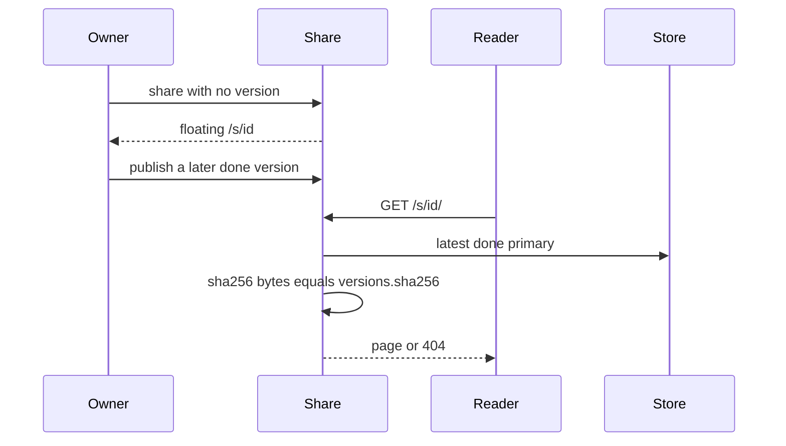

# Stable public share link - Plan

## Goal Capsule

**Objective:** A reader who already has an artifact's public share link still opens the current page after the owner publishes another version.

**Means:** `share` with no version returns one floating `/s/{sid}/` link that serves the latest done version. Older floating ids from before this change keep working and serve that same latest version. An explicit pin keeps a separate link on one version. The request still hashes the stored primary before it renders, and CSP stays the same bytes.

**Authority:** This plan, then the share-hash check in `src/artifactsmith/server.py` and the share rows in `src/artifactsmith/service.py`. A shorter path that skips the hash, the sanitizer, or CSP is out of bounds.

**Stop:** Do not merge or deploy. Do not invent `compose.prod.yaml`. Do not change preview links, the sanitizer, or CSP.

**Who ships:** The PM reviews the pull request and ships it. This work opens the pull request ready for review.

## Product Contract

### Summary

Sharing an artifact today stores that version on the `/s/` id. The next version gets a new id, so a link people already sent shows the old page. After this change, that existing public link serves the latest done version. A pinned link still serves one version. A byte that does not match the recorded sha256 is still a 404.

### Problem Frame

`share` inserts one `shares` row per version and reuses a row only when `artifact_id` and `version` both match. `GET /s/{sid}/` loads that row and compares the stored primary to `shares.sha256` before markdown render or raw serve. Publishing version 2 therefore leaves the version 1 URL on version 1. The owner has to send a new link.

### Requirements

**The link people already have**

- R1. An existing unrevoked, unexpired public share id keeps its URL and serves the artifact's latest done version, including a version created after the share.
- R2. `share` with no version reuses the floating id whose expiry is furthest out when that expiry is more than one day away, the same reuse window as today. A live floating id outside that window still serves until it expires, and a new `share` may mint another id. The returned URL is `/s/{sid}/` on `AM_SHARE_URL`, same shape as today.
- R3. A pinned share, created by passing `version` or `pin=true`, serves only that done version after later versions exist. Its id is distinct from the floating id.

**Checks that stay**

- R4. Before any body is written, the stored primary's sha256 is compared to the hash recorded for the version being served. A mismatch, a missing hash, or a missing object is 404 for the page, `?raw=1`, and `document.md`. The markdown renderer does not run on a mismatch.
- R5. For a floating link the recorded hash is `versions.sha256` of the latest done version. For a pinned link it is `shares.sha256` copied from that version at pin time. Neither path passes an empty hash into the check. Preview `/p/` stays version-pinned and unchecked by this hash, as it is today.
- R6. The preview and share CSP constant is unchanged, including `script-src 'none'` and `img-src data:`. The HTML sanitizer and `classify_href` are not edited.
- R7. `unshare` with no version revokes every public link for the artifact, floating and pinned. `unshare` with a version revokes only pinned links for that version. The floating link stays until a full unshare, expiry, or delete.

**What the owner sees**

- R8. The share tool result names whether the link follows latest or is pinned, and which version a reader would get now. Inspect and status report the floating URL when one is live, including on a version that was not the version stored on the row at creation.
- R9. The changelog says an existing public share link follows the latest done version, and that a pinned link stays on one version. `docs/operations.md` states that this repo has no `compose.prod.yaml` and that production is `compose.yaml` plus the proxy settings already in that doc. `docs/threat-model.md` no longer says every public URL is frozen to one version.

### Actors

- A1. An owner who calls `share` and later publishes another version.
- A2. A reader who opens a `/s/` URL they were sent earlier.
- A3. An owner who needs one historical version to stay on its own URL.

### Flows

- F1. Owner shares version 1, publishes version 2, and the original `/s/{sid}/` returns version 2.
- F2. Owner pins version 1. After version 2, the pin still returns version 1 and the floating URL returns version 2.
- F3. The object bytes for the served version no longer match the recorded sha256. The share URL is 404 and the replacement bytes are not in the body.

### Acceptance Examples

- AE1. Seed a done HTML version whose body contains `HARBOR-17`, share it with no version, mark a second done version whose body contains `HARBOR-18`, and `GET /s/{sid}/` returns 200 with `HARBOR-18` and not only `HARBOR-17`. The sid is the one returned by the first share. Covers R1, R2.
- AE2. After version 2 exists, `share(version=1)` returns a different sid whose `GET` body stays version 1. `share(pin=true)` with no version, while version 2 is the latest done version, returns a sid whose body is version 2 and stays on version 2 after a later version 3. The floating sid still returns the latest done version. Covers R3.
- AE3. Replace the stored primary of the latest done version with different bytes. `GET /s/{sid}/`, `?raw=1`, and `document.md` are 404 and do not contain the replacement. A pinned row whose `shares.sha256` does not match its object is also 404. Covers R4, R5.
- AE4. The CSP header on the floating page equals the current `CSP` constant. `unshare(version=1)` leaves the floating link at 200 and removes the pinned link. `unshare()` with no version makes both 404. Covers R6, R7.
- AE5. After version 2, inspect/status for version 2 reports the floating URL and `follows` latest. The changelog and operations doc match R9. Covers R8, R9.

### Success Criteria

- `make lint`, `make typecheck`, `make test`, and `make denylist` pass.
- Existing share tests that insert eight positional values still run after the new column has a default, or those inserts name their columns.

### Scope Boundaries

- Private `/p/` preview ids stay bound to the version they were minted for.
- Download `/dl/` links stay HMAC-signed and short-lived.
- No query parameter on `/s/{sid}/` selects a version. A reader who has the floating link cannot walk older versions through that URL.
- No new MCP tool. `share` and `unshare` keep their names. The version argument and a `pin` flag are the pin control.
- PDF, DOCX, and XLSX shares still return the stored file. Markdown still renders to HTML after the hash check.
- Do not add `compose.prod.yaml`. It is not in git history and not on this machine.
- Do not merge or deploy. Branch from `a354982` on `main`.

### Key Decisions

- KD1. The link people already sent follows new versions. A separate pin is how an owner freezes one version. Governs R1, R3.
- KD2. The hash check stays in front of render. A floating link uses the latest done version's recorded hash, not the hash copied onto the share row when that row was created. Governs R4, R5.

### Assumptions

- Every existing `shares` row becomes floating (`pinned=0`). A row created earlier with an explicit version cannot be told apart from a default share, so those URLs also follow latest. New calls that pass `version` or `pin=true` are the pins.
- "Latest" means the highest `versions.version` with `status='done'`. A building or failed version is not served. If none are done, the link is 404.
- Expiry and `revoked_at` still apply to the id. A new version does not extend the lifetime.
- Several historical floating ids for one artifact may exist after migration. All of them serve latest. `share` reuses the one whose expiry is furthest out when that expiry is more than one day away, and does not delete the others. Inspect reports that reused URL when several exist.
- `docs/operations.md` is the production compose record. Production runs `compose.yaml`. Slack was not searched.

## Planning Contract

### Key Technical Decisions

- KTD1. Add `pinned INTEGER NOT NULL DEFAULT 0` on `shares` in `DB._migrate`, the same `ALTER TABLE` style as `deleting_at` and `style`. Existing rows read as `0`. A floating row may still store the version number from creation; that number is not the serve target. Governs R1.
- KTD2. `share` with `version is None` and `pin` false inserts or reuses `pinned=0`. `share` with a version, or with `pin=true`, inserts `pinned=1` for that done version (pin with no version freezes the current latest done version) and does not reuse the floating id. Governs R2, R3.
- KTD3. `shared` resolves the row, then the version: pinned uses `shares.version`; floating uses the latest done version for `shares.artifact_id`. It passes that version's hash into the existing compare in `_open_page`. Floating passes `versions.sha256`. Pinned passes `shares.sha256`. A null or empty hash is 404. Do not pass `sha=None` on `/s/`. Governs R4, R5.
- KTD4. `unshare(version)` updates only `pinned=1` rows for that version. `unshare()` with no version updates every live row for the artifact. Governs R7.
- KTD5. `_share_state` reports a live floating row for the artifact ahead of a version-matched pin, so status on a later version still shows the public URL. The share result includes `follows` of `latest` or `pinned` and the version a reader would get now. Governs R8.
- KTD6. Leave `CSP`, `html_sanitize`, `classify_href`, and preview lookup alone. Update the threat-model line that says a public URL is one exact version, the share tool text that says the link stays on that version, the changelog, and the operations note that no `compose.prod.yaml` exists. Governs R6, R9.

### Technical Design

A pinned id uses `shares.version` and `shares.sha256` in that same compare, and does not follow the later version.

### Sequencing

U1 first. U2 depends on U1's behavior being the one the docs describe.

## Implementation Units

### U1. Floating share and pinned share

**Goal:** The existing public id serves the latest done version, a pin stays on one version, and a hash mismatch is still 404.

**Requirements:** R1, R2, R3, R4, R5, R6, R7, R8.

**Files:** `src/artifactsmith/db.py`, `src/artifactsmith/service.py`, `src/artifactsmith/server.py`, `tests/unit/test_server.py`, `tests/unit/test_service.py`.

**Approach:** Migrate `pinned`. Teach `share`, `unshare`, `share_lookup` resolution, and `_share_state` the two modes. In `shared`, choose the version and the hash, then keep `_open_page`'s compare before render. SQLite `INSERT INTO shares VALUES (...)` must list every column, so name the columns or pass `pinned`. An eight-value insert fails once the column exists.

**Test scenarios:**
- AE1. After a second done version, the original sid returns the new body and a second `share()` with no version returns that same sid when its expiry is more than one day away.
- AE2. `share(version=1)` returns a different sid that still shows version 1 after version 2. `pin=true` with no version, while version 2 is latest, freezes version 2.
- AE3. Replacing the latest object's bytes makes `/`, `?raw=1`, and `document.md` 404 without the new text. A pinned row with a wrong `shares.sha256` is 404. A floating link does not 404 merely because `shares.sha256` is still the first version's hash.
- AE4. The floating response CSP equals the current `CSP` literal, including `script-src 'none'` and `img-src data:`. `unshare(version=1)` 404s the pin and leaves the floating link. `unshare()` 404s both.
- A revoked or expired floating id is 404. A version that is not `done` is not served while an older done version exists.
- The existing markdown hash-mismatch test still 404s, and a markdown floating link still returns `text/html` only after the hash matches.

**Verification:** `pytest -o addopts= --cov-fail-under=0 tests/unit/test_server.py tests/unit/test_service.py`

### U2. Changelog, threat model, and the missing prod compose file

**Goal:** An owner can read what the public link does now, and an operator can see that production is `compose.yaml`.

**Requirements:** R9.

**Files:** `CHANGELOG.md`, `README.md`, `docs/threat-model.md`, `docs/operations.md`, `src/artifactsmith/server.py` tool descriptions if U1 did not already update them.

**Approach:** One changelog bullet under Unreleased. One README sentence that a public link follows the latest done version unless pinned. Replace the threat-model asset line and the "Stale public page" control so a floating link is current and a pin plus sha256 is the freeze. In operations, say there is no `compose.prod.yaml` in this repo and production is `docker compose -f compose.yaml` with the reverse-proxy settings already written in `docs/operations.md`. Do not create a compose file.

**Test scenarios:**
- The changelog bullet and the operations sentence are present. No `compose.prod.yaml` file is added.
- `server.CSP` is not edited in this unit. U1 asserts the response header against the current literal.

**Verification:** `make denylist` and a read of the four docs. U1's server test already asserts the CSP constant.

## Verification Contract

- `make lint`
- `make typecheck`
- `make test`
- `make denylist`
- Compose smoke is not required for a share-lookup change that does not change the server image or bind. CI still runs it.

## Definition of Done

- AE1 through AE5 hold.
- `GET /s/{sid}/` never writes a body when the served version's recorded hash does not match the object.
- CSP, the sanitizer, and preview links are unchanged.
- The pull request is open against `main`, not merged, and not deployed.
