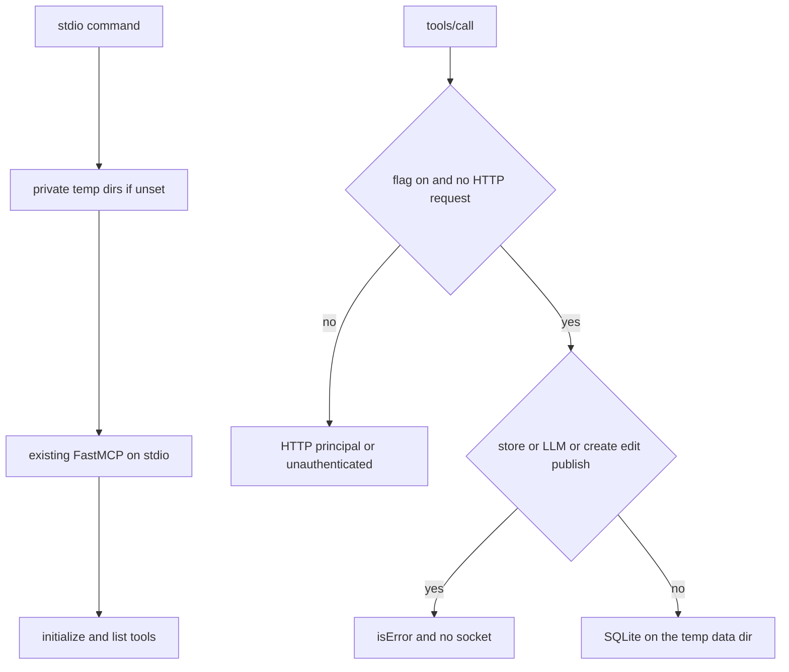

# Glama stdio inspect - Plan

## Goal Capsule

**Objective:** Glama can list ArtifactSmith's tools and assign a quality score, and a person can run the same server on their own machine for Claude Desktop.

**Means:** A local stdio command on the existing tool registry, plus the Glama manifest and the build settings that let `uv sync` finish (KTD1, KTD4).

**Authority:** The request's command, dummy environment, no-network handshake, MCP error rule, local-owner rule, and the exact `glama.json` win over a second tool registry or a production image change.

**Execution:** One pull request, ready for review, branched from `main` at `b1a6d6e`.

**Stop:** Stop if stdio binds a port, if a missing bearer succeeds on HTTP, if a store or LLM tool dials out or returns a success payload, or if `tools/list` differs from the HTTP registry.

The executor implements the change, reviews it, proves it in a clean Python 3.12 or 3.13 container, and opens that pull request.

## Product Contract

### Summary

ArtifactSmith answers Glama's inspector on stdio, with the same tools as the HTTP server, and without opening a socket or accepting an unauthenticated HTTP call.

### Problem Frame

awesome-mcp-servers will not merge a listing that has no Glama score. Glama's build uses Debian Trixie, Python 3.15, `uv sync`, and `mcp-proxy -- artifactsmith serve`. `uv sync` fails because brotli 1.2.0 has no wheel for that interpreter and the image has no C compiler. `artifactsmith serve` speaks HTTP, and the proxy expects a stdio child.

### Requirements

- R1. `artifactsmith stdio` answers `initialize`, `tools/list`, `prompts/list`, and `resources/list` when the environment has only `AM_STORE_ENDPOINT=https://s3.example.com`, a dummy store key and secret, and `OPENAI_API_KEY=sk-dummy`. No database is set up beyond a temp data directory. When `AM_DATA_DIR` and `AM_SECRETS_DIR` are unset, the command creates that directory. Those calls do not open a network connection.
- R2. Tool names, descriptions, and input schemas are the HTTP server's, from the one FastMCP registration that already exists. `publish` stays in the list.
- R3. The stdio process does not listen on a port. HTTP bearer auth is unchanged: a missing, empty, wrong, or revoked token is still 401, and a trial token still does not see `publish`.
- R4. Stdio acts as one local owner with every permission, not as a trial. That owner is not a path through HTTP auth.
- R5. A tool call that needs the object store or an LLM returns an MCP tool error (`isError`) and does not crash, hang on a client timeout, or return a success payload. `create`, `edit`, `publish`, and `delete` count, including `create` with no source files and `delete` before it records a deletion.
- R6. The repo root contains `glama.json` with `$schema` `https://glama.ai/mcp/schemas/server.json` and `maintainers` `["vrijsinghani"]`.
- R7. Docs name the Glama build: Python 3.12 or 3.13, or `build-essential` when the interpreter has no brotli wheel; build step `uv sync`; command `mcp-proxy -- uv run artifactsmith stdio`; the dummy environment. The README has one line on local stdio for Claude Desktop.
- R8. A subprocess test sends `initialize` and `tools/list` to `artifactsmith stdio` under the dummy environment and asserts the tool list matches the HTTP registry. Another test asserts a store-needing tool returns an error. A clean Python 3.12 or 3.13 container runs `uv sync` and the stdio smoke, and the pull request includes that `tools/list` output.
- R9. `artifactsmith serve`, production compose, the production image, and the existing tests stay green. This change does not edit those deploy files.

### Scope Boundaries

The hosted trial snippets stay on HTTP and `mcp-remote`. Share-page behavior, trial quotas, and the login address limits stay as they are. This change does not add an `uv.lock`, does not narrow `requires-python`, and does not install a compiler into the production image. It does not submit the awesome-mcp-servers listing. It does not make stdio build or publish against a real bucket.

#### Deferred to Follow-Up Work

Running `create` and `edit` to completion over stdio, against a real object store and a real model, is later. Pinning brotli, or vendoring a wheel for Python 3.15, is later if Glama cannot select 3.12 or 3.13.

### Success Criteria

Glama's inspector can complete `uv sync` on Python 3.12 or 3.13 and list the tools. The HTTP server still rejects a request with no bearer token.

## Planning Contract

### Key Technical Decisions

- KTD1. Serve the existing FastMCP in `src/artifactsmith/server.py` with its stdio transport. Do not construct a second server and do not call `server.main`. `main` opens the bucket, starts workers, and listens on the API and preview ports. Importing the module does not do those things. The installed `mcp` 1.x `run(transport="stdio")` writes JSON-RPC on stdout and does not bind a port. During a stdio request, `request_context.request` is `None`.
- KTD2. Refuse `create`, `edit`, `publish`, and `delete` before they write SQLite, and refuse a content or manifest read before `inspect` or `status` handles it. Also refuse object-store and LLM client calls before they open a socket. The refusal is an exception that FastMCP reports as `isError`, not `AMError` caught by `_run` or `status`. Those handlers return `{"error": ...}`, which the SDK sends as a successful tool result. `create` with no source files returns a queued job and never calls the model when workers are off, so a guard that lives only inside the LLM client does not meet R5. `inspect` and `status` catch `Exception` and return success fields, so an exception from a store read is not enough. `delete` writes `deleting_at` before it touches the store. The client guards stay as a backstop for callers that do not catch.
- KTD3. The local owner is an in-process flag set only by the stdio command, default off, and `_principal` returns it only when that flag is set and the request object is `None`. A missing request context (`LookupError`) is not that case. A request that is present keeps the HTTP principal even when the flag is on, so the flag cannot upgrade a bearer caller to every permission. `BearerAuth` does not grow a no-token success path. The flag is not an environment variable. The owner is `id` `local`, workspace `local`, every permission, and `trial` false, so the stdio tool list still includes `publish`. `check_access` still confines that principal to workspace `local`.
- KTD4. When `AM_DATA_DIR` or `AM_SECRETS_DIR` is unset, the stdio command points that directory at a private temp directory. R1's temp data directory is this one: the dummy environment does not export those variables, and a caller may still set them. `cli.py` imports `service`, which builds `CFG` at import, so setting the environment inside the command does not move `data_dir` or `secrets_dir`. Assign those fields on the existing `CFG` before `Service` or `DB` is constructed. The defaults those fields would otherwise keep are `/data` and `/secrets`. Do not override a directory the caller set, including the production image's `/data` and `/secrets`; the docs say not to point stdio at those. Stdio does not call `logging.basicConfig` and does not print to stdout. mcp-proxy is the process that listens; artifactsmith is the child. Document the command the request names. Do not add `--port` to it.

### High-Level Technical Design

### Assumptions

These were not confirmed in the request. They are the bets that make R1 and R5 hold on the code that exists today.

- SQLite-only tools may succeed against the temp database: `list_artifacts`, `share`, `unshare`, `revoke_previews`, `export`, `inspect` of an artifact with no done version, and `status` of a version that is not a done publish. `inspect` of a done version reads `manifest.json` even when content is off, and `status` of a done published version reads it too; those calls are the manifest refusal in KTD2, not SQLite successes. `check_access` confines the owner to workspace `local`. Another workspace stays forbidden. A share row for workspace `local` in a data directory the HTTP server also opens is a public URL, and `export` can mint a download URL if it can write the secrets directory. When the variables are unset, both directories are a private temp directory. Do not point stdio at the production data or secrets directory.
- On stdio, `status` does not block on `wait`. Workers are not running, and `wait` would poll for up to 90 seconds.
- The dummy names the proof uses are `AM_STORE_KEY` and `AM_STORE_SECRET`. Those are the first names the config reads.
- Glama's admin form, not `glama.json`, carries the Python version and the launch command. The schema requires only `maintainers`.
- The container proof is pasted into the pull request. CI stays on the existing Python 3.11 and 3.12 jobs. This change does not add a workflow.
- brotli 1.2.0 publishes wheels for CPython 3.6 through 3.14 and none for 3.15. Documenting 3.12 or 3.13 is what lets `uv sync` install a wheel. `build-essential` is the alternative when the interpreter has no wheel. If Glama stays on 3.15 and does not install a compiler, the build still fails. This change does not fix that case in the package.

### Sources

- Installed `mcp` 1.30.0, `FastMCP.run`, and the v1.26.0 tag of the Python SDK. The unversioned SDK page is mcp 2.x and does not apply under `mcp>=1.26,<2`.
- sparfenyuk/mcp-proxy: a non-URL command is a stdio child, and the proxy listens.
- https://glama.ai/mcp/schemas/server.json requires `maintainers` only.
- https://pypi.org/pypi/brotli/1.2.0/json has no `cp315` wheel.
- MCP authorization and stdio transport, 2026-07-28: stdio should not use the HTTP authorization flow; a local server and its client share one trust domain; tool failures are `isError`, not a success payload.

## Implementation Units

### U1. Stdio command and offline refusal

**Goal:** The process answers the inspector handshake and refuses store and model work without a socket or an HTTP auth change.

**Requirements:** R1, R2, R3, R4, R5, R8, R9.

**Dependencies:** none.

**Files:** `src/artifactsmith/cli.py`, `src/artifactsmith/server.py`, `src/artifactsmith/store.py`, `src/artifactsmith/llm.py`, `tests/unit/test_stdio.py`, `tests/unit/test_server.py`.

**Approach:**

- Add `stdio` beside `serve` in the CLI dispatch. The CLI module has already imported `service` and built `CFG`. When `AM_DATA_DIR` or `AM_SECRETS_DIR` is unset, assign `CFG.data_dir` or `CFG.secrets_dir` to a private temp directory before `Service` or `DB` is constructed. Then set the in-process flag, import the server, and run the existing FastMCP on stdio. Setting those variables after import does not move `CFG`.
- Return the local owner from `_principal` only under KTD3. Leave `BearerAuth` as it is.
- Apply KTD2 before the handlers it names, and keep the client backstop at the object-store and LLM call sites.
- Apply KTD3 in `_principal`. Do not start workers and do not call `ensure_bucket`.

**Execution note:** The subprocess test is the proof that boot did not build a second registry. Pass the dummy environment explicitly. The SDK's stdio client does not forward the parent's `AM_*` values.

**Patterns to follow:** `cmd_serve` in `src/artifactsmith/cli.py`. `_principal` and `BearerAuth` in `src/artifactsmith/server.py`. `tests/unit/test_readme_tools.py` for the tool-list comparison. `tests/unit/test_server.py` for the 401 cases.

**Test scenarios:**

- A subprocess with the dummy environment, and with `AM_DATA_DIR` and `AM_SECRETS_DIR` unset, answers `initialize`, then `tools/list`. It does not create `/data` or `/secrets`. Names, descriptions, and input schemas match `await server.mcp.list_tools()`. `publish` is present. `prompts/list` and `resources/list` return empty lists. The child exits when stdin closes. The child has no listening socket.
- `create` with no source files, over stdio, returns `isError` and does not leave a queued job. It does not contact `s3.example.com` or `api.openai.com`.
- `inspect` with content requested returns `isError` rather than a success payload that carries `content_error`. `inspect` of a done version with content left off returns `isError` and does not call the store. `status` of a done published version does the same. `status` of a version that is not done stays on SQLite and does not block on `wait`.
- With the flag off, `_principal` on a missing request is still unauthenticated. With the flag on, a missing bearer is still 401 and still sends `WWW-Authenticate`, a trial request still omits `publish`, and a token without `share` still cannot share. `LookupError` does not become the local owner.
- A stdio call that names another workspace is rejected. `delete` returns `isError` and does not write `deleting_at`.
- `artifactsmith serve` is still the HTTP boot. An unknown command still exits 2.

**Verification:** The new tests fail before the command exists and pass after. `make ci` still passes.

### U2. Glama manifest and docs

**Goal:** A reviewer can see the file Glama reads and the settings that make its build succeed.

**Requirements:** R6, R7, R9.

**Dependencies:** U1.

**Files:** `glama.json`, `docs/operations.md`, `README.md`, `CHANGELOG.md`.

**Approach:**

- Write `glama.json` as the two fields in R6, at the repo root.
- In `docs/operations.md`, state Python 3.12 or 3.13, the `build-essential` alternative, `uv sync`, the command `mcp-proxy -- uv run artifactsmith stdio`, and the dummy environment JSON. Say the proxy listens and this process does not, and that stdio is the owner of whatever data directory it is given.
- Add one README sentence for Claude Desktop on the same machine: run `artifactsmith stdio`. Do not change the hosted-trial `mcp-remote` snippets.

**Patterns to follow:** The deploy section in `docs/operations.md`. The "MCP client on another machine" paragraph in `README.md`.

**Test scenarios:**

- Test expectation: none for a new behavioral test. The manifest is the two-field document. The README sentence does not replace the trial connector. Existing README tool-table tests still pass.

**Verification:** The files exist and name the command and the Python versions. Production compose and the Dockerfile are untouched.

## Verification Contract

Run `python -m pytest -o addopts= --cov-fail-under=0 tests/unit/test_stdio.py tests/unit/test_server.py tests/unit/test_readme_tools.py`, then `make ci`.

In a clean `python:3.12` or `python:3.13` container, install `uv`, run `uv sync`, and run the stdio smoke with the dummy environment. Paste the `tools/list` output into the pull request. The container must not be the production image and must not change `docker/Dockerfile`.

## Definition of Done

- R1 through R9 hold.
- The pull request is ready for review, not a draft, and includes the container `tools/list` output and the security note on the local owner.
- Abandoned experiments are not left in the diff.
- `docker/Dockerfile`, `compose.yaml`, `compose.prod.yaml`, and `compose.test.yaml` have no diff.
