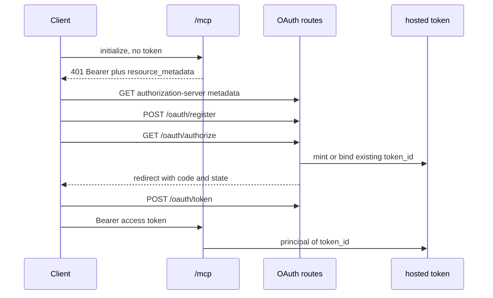

# OAuth on /mcp - Plan

## Goal Capsule

**Objective:** A person who signs in with their email on the hosted copy can use Claude.ai as themselves, and the existing per-person build cap, hourly cap, daily spend cap, and user count still apply to that person. Clients that already send a bearer token keep working.

**Means:** One authorization server in this process. Each completed sign-in is bound to the existing hosted token for that email (KTD1, KTD5).

**Authority:** The Phase A spec, the hard rules, and the later scope note win over the MCP SDK defaults. REST and OpenAPI stay out. ChatGPT directory login, the draft privacy page, and the demo account are in.

**Execution:** One pull request, ready for review, not merged. Branch from `main`.

**Stop:** Stop if a metadata document or `WWW-Authenticate` value would contain a private, loopback, or tailnet host. Stop if an existing bearer token stops authenticating, or if a second hosted token is minted for an email that already has one.

## Product Contract

### Summary

Phase A adds an OAuth authorization server and accepts those access tokens on `/mcp`. Each person maps to the hosted token they already have, or to one minted by the same sign-up checks as `/try`. Static bearer tokens stay. The `/try` page and README say Claude.ai custom connectors sign in with OAuth, ChatGPT personal plans still cannot add a custom MCP server, and a ChatGPT Business or Enterprise admin can add it.

### Problem Frame

Claude.ai custom connectors sign in with OAuth or with no auth. A fixed bearer header is a limited beta. A single shared key would put every person on one hosted token, so the build cap, the hourly cap, the daily spend cap, and the user count would apply to the crowd instead of the person. Pasting a token into chat puts a secret in the transcript.

### Requirements

- R1. `GET /.well-known/oauth-authorization-server` and `GET /.well-known/oauth-protected-resource` return issuer and endpoints built from `AM_API_URL`. The same protected-resource document is also served at `/.well-known/oauth-protected-resource/mcp`. When `AM_API_URL` is not https, or its host is private or loopback, both documents return 404 and the URL is not in the body.
- R2. `POST /oauth/register` accepts a public client (`token_endpoint_auth_method` exactly `none`) whose redirect URIs are on the allowlist. `GET /oauth/authorize` requires `response_type=code`, `client_id`, an allowlisted `redirect_uri`, `state`, and PKCE S256. `POST /oauth/token` accepts `authorization_code` and `refresh_token`. `POST /oauth/revoke` exists. A wrong redirect, a missing `state`, a bad `code_verifier`, a reused code, or an expired code returns an error and no token.
- R3. A new email runs the same sign-up checks as `POST /try`. When email verify is off, the server mints the hosted token and finishes the redirect. When email verify is on, it emails a magic link that finishes the redirect. An email that already has a hosted token always gets a magic link, including when verify is off. No SMTP means a plain failure and no code. A revoked hosted token is refused.
- R4. An OAuth access token resolves to the same principal as that person's hosted token. A create through it counts against that token. After one build, `builds_remaining` is 19. The lifetime loop stops with the existing "you've used the 20 hosted builds" text. The hourly limit still fires.
- R5. A static bearer token on `/mcp` behaves as it does today, including the `{"error":"unauthorized"}` body. A 401 on a public https origin adds `resource_metadata`. A 401 on a private origin is `WWW-Authenticate: Bearer` with no URL.
- R6. Refresh rotates. The old refresh token fails afterwards. Codes last 10 minutes. Access tokens last 1 hour. Refresh tokens last 30 days. Only SHA-256 hashes are stored.
- R7. Revoking the hosted token makes its OAuth access token return 401. Idle-workspace purge deletes that token's OAuth rows.
- R8. `/try` and the README say Claude.ai custom connectors work through OAuth, ChatGPT personal plans still cannot add a custom MCP server, and ChatGPT Business or Enterprise admins can add it. No user-facing "trial" or hype. No existing user-facing feature is removed.
- R9. No OAuth or `/mcp` response body or header contains a private, LAN, or tailnet host.

### Key Decisions

- **One person, one hosted token.** A shared GPT key was rejected because it collapses the caps and the user count. (session-settled: user-directed — chosen over a shared API key and over pasting a token into chat: the caps and the scorecard stay per person.) Governs R3, R4, R7.
- **Phase A only.** REST, OpenAPI, the privacy page, and the confidential GPT client are a later phase. Governs the scope boundary below.
- **`state` is required on the authorize request.** The MCP spec only says clients should send it. This product's tests and hard rule reject a missing `state`. Governs R2.
- **Do not guess the ChatGPT MCP callback.** It is added only after OpenAI's docs or a real Business-workspace test confirm it. The GPT Action patterns in the spec are allowlist entries, not Phase B endpoints. Governs R2.

### Scope Boundaries

In: the authorization server, OAuth on `/mcp`, the allowlist, the login page, the copy change, and the Phase A tests.

Out: Phase B (`/openapi.json`, `/api/v1/documents`, `/privacy`, a confidential client that skips PKCE). CIMD URL fetches. SWAG and production env changes. A second quota system.

#### Deferred to Follow-Up Work

- Client ID Metadata Documents, once a fetch can be bounded so it cannot reach a private host.
- The ChatGPT MCP-connector redirect, once it is confirmed.
- Phase B, after Gate 0.

### Acceptance Examples

- AE1. With `AM_API_URL=https://trial.example`, metadata `issuer` is `https://trial.example` and `resource` is `https://trial.example/mcp`. With `http://127.0.0.1:8780`, both well-known GETs are 404 and the body has no `127.0.0.1`.
- AE2. Register, authorize a new email, exchange the code, `initialize` on `/mcp` returns 200, and one create leaves `builds_remaining` at 19.
- AE3. An existing email without the magic link gets no code. With the link, the code uses the same `token_id`.
- AE4. Wrong redirect, missing `state`, bad verifier, reused code, and expired code each fail with no token.
- AE5. The second use of a refresh token fails. A revoked hosted token makes the OAuth access token 401.
- AE6. A static bearer still initializes. Its missing-token 401 body is unchanged and carries `WWW-Authenticate`.

### Actors

- A1. A person connecting Claude.ai or Claude Code with their email.
- A2. An existing bearer client (Claude Desktop, Claude Code snippet, Cursor).
- A3. The operator, who still revokes hosted tokens from the CLI.

### Key Flows

- F1. New email, verify off: register, authorize, mint, redirect with code, token, `/mcp`.
- F2. New email, verify on, and every existing email: authorize shows "check your inbox", the mail link opens a confirm page, POST consumes the link and redirects with the code.
- F3. Bearer request: hosted-token hash matches first. Otherwise a live OAuth access hash loads that hosted token's principal.

## Planning Contract

### Key Technical Decisions

- KTD1. Do not mount the MCP SDK auth routes and do not pass `auth=` into FastMCP. `mcp` 1.30.0 `create_auth_routes` advertises `client_secret_post` and `client_secret_basic`, treats `state` as optional, and `validate_issuer_url` accepts a loopback issuer. `RequireAuthMiddleware` would reject today's `asmb_` bearers and change the 401 body. Own routes live beside the trial pages. The SDK stays the MCP protocol library only.
- KTD2. Advertise DCR, not CIMD. Metadata includes `registration_endpoint`, `token_endpoint_auth_methods_supported: ["none"]`, and `code_challenge_methods_supported: ["S256"]`. It does not set `client_id_metadata_document_supported`. Claude's own doc (fetched 2026-10-17) uses CIMD only when both CIMD flags are present, and otherwise looks for `registration_endpoint`. A CIMD fetch is an outbound request to a client-supplied URL and is out of this phase.
- KTD3. Publish metadata only when `AM_API_URL` is https, has no userinfo, and `renderers.safety._host_is_private` is false for the host. Build every absolute URL from `AM_API_URL`, never from the `Host` header. `resource` is `{origin}/mcp`. `WWW-Authenticate` on a public origin points at `{origin}/.well-known/oauth-protected-resource`, which is the URL in Claude's 401 example. The path-inserted document is the same JSON, for clients that probe `/.well-known/oauth-protected-resource/mcp`. On a private origin the header is exactly `Bearer`.
- KTD4. The magic link does not redirect on GET, and it does not set a flag another browser can redeem. The pending authorization is bound to an HttpOnly cookie set on the browser that opened `/oauth/authorize`. The mailed link stores only a hash. GET shows the redirect hostname, a loopback warning when the host is loopback, and a confirm button. POST issues the code only when that cookie matches the pending row, then 303s to the stored redirect. A scanner, or a person who opens the link on another device, sees a plain "go back to the browser where you started" page and no code is issued. TTL stays `AM_TRIAL_LINK_TTL_S`.
- KTD5. Bearer resolution stays in `BearerAuth`. Look up `tokens.token_hash` first. On a miss, look up a non-expired, non-revoked `oauth_tokens.access_hash` and load the principal of its `token_id` with the same fields the hosted token yields (`id`, `name`, `workspace`, `perms`, `trial`). A revoked or missing hosted token yields no principal. Quotas are not given a second path.
- KTD6. New tables in `SCHEMA`, no Alembic: `oauth_clients`, `oauth_grants` (authorization codes), `oauth_tokens`. Store SHA-256 hex only for codes, access tokens, and refresh tokens. Rotation and reuse run in one `db.tx()`: a conditional update marks a still-live refresh rotated and the successor is inserted in that same transaction. If the update matches nothing, the family is revoked and nothing is inserted. The rotated hash stays so a replay can find the family. Access 1 hour, refresh 30 days, code 10 minutes, matching the spec.
- KTD7. `AM_OAUTH_REDIRECTS` defaults to `https://claude.ai/api/mcp/auth_callback`, `https://chatgpt.com/connector_platform_oauth_redirect`, and loopback `http://127.0.0.1/callback` plus `http://localhost/callback` on any port. Those two HTTPS callbacks are exact. Loopback is http only, those two hosts, path exactly `/callback`, any port, no query, fragment, or userinfo. `[::1]`, custom schemes, other paths, and private hosts are rejected. `connector/oauth/*` and GPT Action `g-*` patterns are not in the default list; an operator can add them. A wildcard segment matches `[A-Za-z0-9_-]+` only, and any URI with `?`, `#`, or `%` fails a pattern. Registration stores the client's list after that check. Authorize requires the requested URI to be one of the stored ones, with the loopback port exception. The consent page shows the redirect hostname before a code is issued.
- KTD8. An existing email skips the new-signup caps and still requires mail. A new email uses normalize, disposable block, per-IP day cap, daily signup cap, and `AM_TRIAL_ENABLED`. Both successful link sends show the same "check your inbox" sentence. Rejected new signups keep the existing `/try` sentences. When verify is off for a new email, the browser is redirected with the code and the raw hosted token is not shown on that page.
- KTD9. Idle purge, in the same transaction as the hosted-token revoke, deletes `oauth_grants` and `oauth_tokens` for that `token_id`. DCR client rows stay.

### High-Level Technical Design

Grant states: pending code, used code, live access plus refresh, rotated refresh, revoked family. A code leaves "pending" once. A refresh leaves "live" on use and the new refresh is the live one. Presenting the old refresh revokes the family.

### Assumptions

- Claude sends `state`. If a real connector omits it, R2 still fails that request. That is the hard rule, recorded under Risks.
- Clients that omit RFC 8707 `resource` still get a token whose audience is `{origin}/mcp`. A present `resource` that differs is `invalid_target`.
- `[::1]` is not on the default allowlist. The Claude page fetched on 2026-10-17 names `localhost` and `127.0.0.1`, path `/callback`.
- The spec says the magic link completes the authorization. Completion is the confirm POST in the browser that started the flow. GET does not redirect, and another device cannot finish it.
- OAuth login for an existing email still sends mail when the hosted copy is closed to new signups.

### System-Wide Impact

`/mcp` stays the only tool surface. OAuth does not add tools and does not grant `publish`. The human consent step stays human-only. Bearer clients and OAuth clients share one workspace row per email, so a create from either client sees the same artifacts and the same remaining builds. Public paths must include the well-known URLs, `/oauth/authorize`, `/oauth/token`, `/oauth/register`, `/oauth/revoke`, and the magic-link confirm path, or `BearerAuth` will 401 them. `HostGuard` still applies. Mail delivery for returning users depends on SMTP. The spec's deploy note (SWAG) is not part of this change.

### Risks & Dependencies

- Returning users get no code when SMTP is unset or mail is not delivered. The page says so in plain text. DKIM is an operator item, not this PR.
- Requiring `state` is stricter than the MCP authorization spec (2026-07-28). A client that sends S256 and omits `state` cannot connect. The spec tests demand that failure.
- DCR creates a client row per connection. That is what Claude does when CIMD is not advertised. Volume is acceptable for a custom connector. CIMD is deferred because the fetch is unsafe until it is bounded.
- `mcp` is pinned `>=1.26,<2`. This plan does not depend on SDK auth classes, so a later 1.x bump does not have to match their route table.

### Sources

- Claude connector authentication, fetched 2026-10-17: https://claude.com/docs/connectors/building/authentication — `oauth_dcr` supported by default, callback `https://claude.ai/api/mcp/auth_callback`, PKCE S256, 401 `resource_metadata` example without a path suffix, Claude Code loopback on any port for `localhost` and `127.0.0.1`, CIMD only when both CIMD metadata flags are set, otherwise DCR.
- Claude troubleshooting, same day: https://claude.com/docs/connectors/building/troubleshooting — path-inserted protected-resource URL `/.well-known/oauth-protected-resource/mcp`.
- MCP authorization 2026-07-28: https://modelcontextprotocol.io/specification/2026-07-28/basic/authorization
- Local behavior: `BearerAuth` in `src/artifactsmith/server.py`, `mint_trial` and `purge_idle_trials` in `src/artifactsmith/trial.py`, `_host_is_private` in `src/artifactsmith/renderers/safety.py`, `_public_https_origin` is stricter (rejects every IP) and is not the metadata predicate.

## Implementation Units

### U1. Tables, allowlist, and public origin

**Goal:** The database and config can store clients and grants, and can tell a publishable origin from a private one.

**Requirements:** R1, R6, R9.

**Dependencies:** none.

**Files:** `src/artifactsmith/db.py`, `src/artifactsmith/config.py`, `src/artifactsmith/oauth_origin.py`, `.env.example`, `tests/unit/test_oauth.py`.

**Approach:** Add the three tables to `SCHEMA`. Add `AM_OAUTH_REDIRECTS` with the KTD7 default. Put the public-origin check and the redirect matcher in a small module so pages and the protocol share one implementation. Follow `tokens.token_hash` and `trial_links.code_hash` for hash columns.

**Patterns to follow:** `DB._migrate` column adds, `_setting` in `config.py`, `_host_is_private`.

**Test scenarios:**
- A https DNS name that is not private returns that origin. `http://127.0.0.1:8780`, `https://10.0.0.5`, and `https://x.nip.io` do not.
- The default allowlist accepts the Claude callback, a `g-abc` GPT callback, and `http://127.0.0.1:9/callback`. It rejects `https://evil.example/cb`, `http://127.0.0.1:9/steal`, `http://localhost.evil/callback`, and `[::1]`.

**Verification:** Those two cases pass in `tests/unit/test_oauth.py`.

### U2. Register, token, revoke

**Goal:** A DCR client can exchange a code and rotate a refresh token.

**Requirements:** R2, R6.

**Dependencies:** U1.

**Files:** `src/artifactsmith/oauth_protocol.py`, `tests/unit/test_oauth.py`.

**Approach:** Registration returns 201 and a random `client_id`, no secret. Reject any auth method other than `none`, including an omitted method. Token requests are form-urlencoded. Authorization-code exchange checks the verifier with S256, marks the code used inside one `db.tx()`, and inserts the access and refresh hashes in that same transaction. Refresh follows KTD6. A second presentation revokes the family and returns `invalid_grant`. Revoke of an unknown token returns 200. Do not put a raw token or code in a log line.

**Patterns to follow:** `db.tx()`, `hashlib.sha256` hex in `BearerAuth`.

**Execution note:** Write the failure cases in R2 before the happy exchange.

**Test scenarios:**
- Register with `none` and the Claude redirect returns a `client_id`. A private redirect and an omitted auth method return 400 and store nothing.
- A good verifier returns an access token and a refresh token. A bad verifier returns `invalid_grant` and leaves the code unused. A second good exchange returns `invalid_grant`.
- An expired code returns `invalid_grant`.
- First refresh returns a new refresh token. The old refresh token then returns `invalid_grant`, and the access token from the first refresh no longer works. Two overlapping refreshes of the same token leave one live refresh, not two.
- Revoke of the current access token makes the next `/mcp` call 401.

**Verification:** The cases above pass without a row that contains a raw token or code.

### U3. Authorize page and magic link

**Goal:** The browser step binds the grant to the right hosted token.

**Requirements:** R2, R3, R8.

**Dependencies:** U1, U2.

**Files:** `src/artifactsmith/web/oauth_pages.py`, `src/artifactsmith/trial.py`, `tests/unit/test_oauth.py`.

**Approach:** The page matches the `/try` form style: one email field, short plain text, no "trial". It shows the redirect hostname, and a one-line warning when that host is loopback. CSRF uses the existing signed cookie, and the pending authorization is the HttpOnly cookie from KTD4. New emails call the same helpers `POST /try` uses, then either mint and redirect in this browser or send the link. Existing emails always send the link and never call `mint_trial`. The confirm GET renders the hostname and a button. The confirm POST issues the code only with the matching cookie and 303s to the stored redirect with `code` and `state`. Missing cookie, missing `state`, and a bad redirect render an error on our origin and do not redirect. SMTP failure for a required link renders a plain "email is not configured" message and stores no code.

**Patterns to follow:** `issue_link` / `consume_link`, the `/try` error strings, `trial_pages._form`.

**Test scenarios:**
- New email, verify off: one `tokens` row, 303 to the redirect with `state`, no raw token in the HTML.
- New email, verify on: no code until the confirm POST in the browser that started authorize. GET of the link does not 303 to the client. The same POST without that cookie does not 303 and does not mark the grant redeemable from another browser.
- Existing email, verify off: no second `tokens` row, no code until the confirm POST, and the issued code's `token_id` is the original.
- Existing email with SMTP unset: 200 plain failure, no code, no new token.
- Disposable email, closed signups, and a full daily cap: no token, and the copy matches `/try`.
- Revoked hosted token: confirm POST does not redirect with a code.

**Verification:** AE3 holds, and the HTML contains neither "trial" nor "free builds".

### U4. Wire `/mcp` and purge

**Goal:** OAuth access tokens and bearer tokens both reach the existing principal, and private origins stay unpublished.

**Requirements:** R1, R4, R5, R7, R9.

**Dependencies:** U2, U3.

**Files:** `src/artifactsmith/server.py`, `src/artifactsmith/trial.py`, `src/artifactsmith/web/routes.py`, `tests/unit/test_oauth.py`, `tests/unit/test_server.py`.

**Approach:** Mount the OAuth routes on the pages app and add those paths to the `ApiApp` public list. Extend `BearerAuth` per KTD5 and KTD3. Add the OAuth deletes next to the `web_sessions` delete in `purge_idle_trials`. Do not change `service._check_quota`.

**Patterns to follow:** the existing `/try` bypass in `ApiApp`, `principal_from_row`.

**Test scenarios:**
- Public origin: both well-known GETs are 200, `resource` is `{origin}/mcp`, and a tokenless `/mcp` 401 body is `{"error":"unauthorized"}` with `resource_metadata` equal to `{origin}/.well-known/oauth-protected-resource`.
- Private origin: both well-known GETs are 404, and the 401 header is exactly `Bearer`.
- DCR client, new email, verify off: `/mcp` initialize is 200 and one create reports `builds_remaining` 19.
- Twenty hosted builds then the next create returns the existing lifetime sentence. The hourly limit returns the existing hourly sentence.
- A static bearer still initializes. After the hosted token is revoked, the OAuth access token gets 401.
- Idle purge removes that token's OAuth rows. A response scan with `_host_is_private` finds no private host.

**Verification:** AE1, AE2, AE5, and AE6 pass, and `tests/unit/test_server.py` bearer cases still pass.

### U5. `/try` and README copy

**Goal:** The client lines match what Phase A actually allows.

**Requirements:** R8.

**Dependencies:** U4.

**Files:** `src/artifactsmith/web/trial_pages.py`, `README.md`, `tests/unit/test_trial.py`, `tests/unit/test_readme_tools.py`.

**Approach:** Apply the attached copy patch, then replace the "can't connect yet" and "this copy uses a token" sentences. Keep the Claude Desktop, Claude Code, and Cursor bearer instructions. State the three facts: Claude.ai custom connectors sign in with OAuth, ChatGPT personal plans cannot add a custom MCP server, and a ChatGPT Business or Enterprise admin can add it.

**Patterns to follow:** the existing landing assertions in `tests/unit/test_trial.py`.

**Test scenarios:**
- The landing page contains the Claude.ai OAuth sentence and the ChatGPT personal-plan sentence, and does not contain "any MCP client", "free builds", "free trial", or "no card".
- The README hosted section says the same three facts and still documents the bearer header.

**Verification:** The two assertions pass.

## Verification Contract

`make ci` from the repo root (ruff, mypy, pytest with the coverage gate, denylist). The Phase A cases live in `tests/unit/test_oauth.py` and the copy cases in `tests/unit/test_trial.py`. Existing bearer cases in `tests/unit/test_server.py` stay green. No new e2e compose case. The denylist must still pass, so tests use `https://trial.example` and never a tailnet host.

## Scope update

ChatGPT is in this change, not a later phase. The MCP SDK 1.30.0 implements Client ID Metadata Documents on the OAuth client only. The server does not fetch a metadata document or check `private_key_jwt`. Ship DCR plus the static public client, and say that in the pull request.

Allow `https://claude.ai/api/mcp/auth_callback` and, because issuer identification is on, `https://chatgpt.com/connector_platform_oauth_redirect`. Do not allow `https://chatgpt.com/connector/oauth/*` or the GPT Action `g-*` patterns by default. Cite the Claude authentication page and OpenAI's plugin auth page.

`AM_OAUTH_DEMO_EMAIL` and `AM_OAUTH_DEMO_PASSWORD` are off unless both are set. That account signs into one fixed hosted token, sees a sample page, and has `AM_OAUTH_DEMO_BUILD_LIMIT`. It does not use the shared spend cap. An existing email still gets a code only after the magic link. A new email can finish without mail when verify is off. `/privacy` is a short draft.

## Definition of Done

- U1 through U5 meet their verification lines.
- `make ci` is green.
- The diff does not publish a private host, does not remove a user-facing route, and does not add Phase B routes.
- Abandoned experiments are not left in the diff.
- The pull request body cites the Claude authentication doc and the troubleshooting doc for DCR and the metadata Claude expects.
